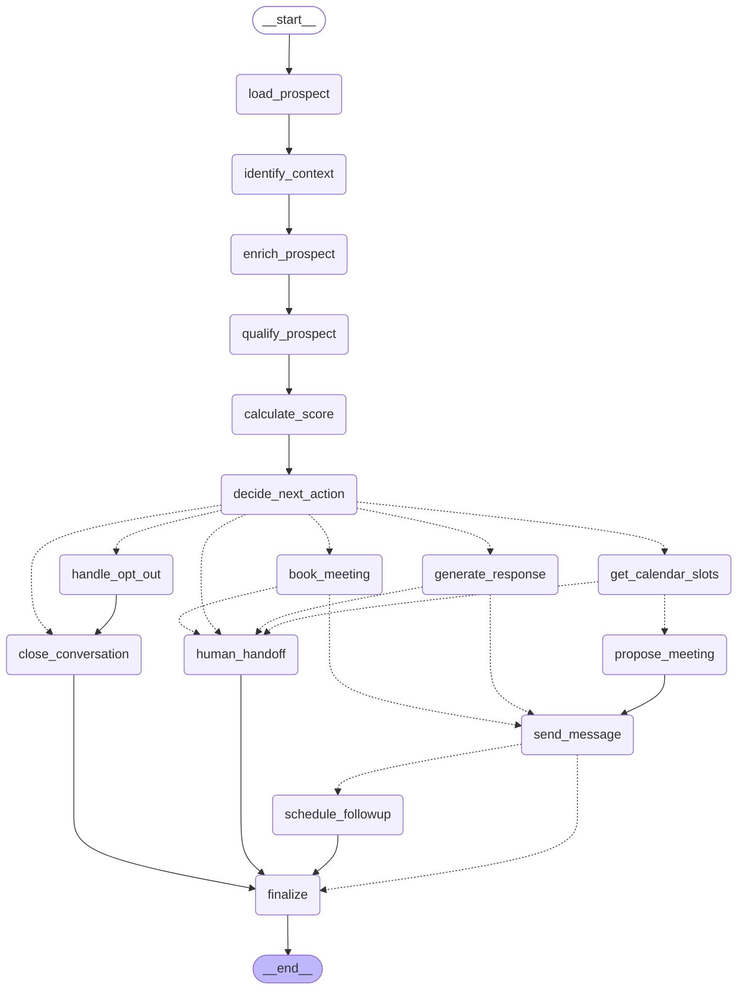

# Workflow agentique (LangGraph)

Le workflow transforme un signal d'intérêt en parcours structuré (CdC §6.1, §9.3) :
**signal → identification → enrichissement → qualification → scoring → décision → action**.
Le modèle de langage *lit* le message et *rédige* ; ce sont des règles de code qui *décident*.

## Graphe (généré depuis le code)

Les flèches pointillées sont des routages conditionnels.



## Qui décide quoi

| Étape | Qui | Détail |
|---|---|---|
| Lire le message (intention, sentiment, infos de profil) | Modèle de langage, sortie structurée | `Qualification` (`app/graph/state.py`) |
| Détecter une demande d'arrêt ou un cas sensible | **Mots-clés, sans modèle** | Filet de sécurité indépendant du modèle (S-03) |
| Calculer le score | Règles | Signaux → points (`app/services/scoring.py`) |
| **Choisir la prochaine action** | **Règles** | `app/graph/policy.py::decide`, chaque décision porte sa justification (OB-05) |
| Changer l'étape | Règles | Jamais en arrière, toujours justifié (`policy.stage_for`) |
| Rédiger la réponse | Modèle de langage | Sur extraits validés uniquement, vérifiée ensuite par le code |
| Proposer des créneaux | Code, message déterministe | Uniquement des créneaux réels de l'agenda |

### Règles de décision (ordre de priorité)

1. **Désinscrit ou demande d'arrêt** → opt-out enregistré, relances annulées, aucun message (scénario 4).
2. **Cas qui exigent un humain, quoi qu'il arrive** : modèle indisponible, situation sensible → transfert (F-20).
3. **Demande de rendez-vous** (même formulée « avec un conseiller ») → l'agent organise le rendez-vous lui-même
   avec des créneaux réels (F-18). Sans agenda, le transfert a lieu juste après : le prospect n'est jamais bloqué.
4. **Demande d'un humain, cas particulier, incertitude** (< 0,5) → transfert.
5. **Pas intéressé** → clôture, aucune relance.
6. **Rendez-vous** : créneau choisi → réservation ; score ≥ 50 avec qualification complète → proposition de créneaux.
7. **Message neutre et score ≤ 24** → entretien espacé (nurturing) et relance programmée (scénario 1).
8. Sinon → poursuite de l'échange et qualification.

**Relances** : toute réponse du prospect, tout transfert à un humain et toute clôture annulent les relances en attente (F-16).

**Questions** : une question précise sans extrait de la base de connaissances est transférée (jamais devinée). Une
question sur la *liste* des formations (`asks_catalogue`) est répondue grâce à la liste validée des trois programmes
(noms et publics uniquement, aucun chiffre) qui figure dans les consignes du modèle.

Les seuils sont des valeurs de conception (CdC §4.2), regroupées en tête de `policy.py`.

## Garde-fous

| Risque | Parade | Exigence |
|---|---|---|
| Le modèle invente un prix, une durée, une date | Réponse **vérifiée par le code** : tout chiffre doit figurer dans les extraits ou la conversation ; un seul nouvel essai plus strict, sinon transfert | NF-10 |
| Question hors base de connaissances | Transfert au conseiller, jamais de réponse devinée | F-20, NF-10 |
| Disponibilité inventée | Aucun créneau cité s'il ne vient pas de l'agenda ; agenda absent → transfert | NF-10, F-18 |
| Prospect désinscrit | Détection sans modèle ; envoi sortant refusé par le service même si le workflow se trompait | S-03 |
| API du modèle en panne ou quota dépassé | Nouveaux essais avec attente croissante, puis transfert avec résumé sans modèle | NF-05 |
| Données personnelles envoyées au modèle | Prénom et informations de qualification seulement : jamais email, téléphone ni identifiants | S-01 |
| Réponse non traçable | Chaque exécution est journalisée (noeuds, décision, justification, scores) | NF-04, OB-05 |
| Fausse identité | L'agent se présente comme assistant virtuel et ne se fait jamais passer pour un humain | Transparence |

## Changer de fournisseur de modèle de langage

Le graphe ne connaît que l'interface `LanguageModel` (`app/graph/ports.py`). Un fournisseur est un adaptateur.

```bash
# Gemini (par défaut)
LLM_PROVIDER=gemini
LLM_MODEL=gemini-2.5-flash
GEMINI_API_KEY=...        # dans votre .env local, jamais dans Git

# OpenAI : même interface, aucune modification du workflow
pip install langchain-openai
LLM_PROVIDER=openai
LLM_MODEL=<nom du modèle>
OPENAI_API_KEY=...
```

> Les intentions (`question`, `meeting_request`, `needs_advisor`...) sont lues par le modèle, avec des définitions
> précises et des exemples dans `prompts.py`. Un filet de sécurité par mots-clés couvre les cas où il hésite entre « veut un
> rendez-vous » et « veut un conseiller ».

Ajouter un autre fournisseur (Anthropic, Hugging Face...) : écrire une fonction `_build_xxx` dans
`app/integrations/llm/factory.py` et l'inscrire dans `_BUILDERS`. Aucun autre fichier ne change.
Sans clé valide, l'agent ne plante pas : il transfère au conseiller (motif `llm_indisponible`).

## Utilisation

```bash
# 1. Créer un prospect, une conversation et un message entrant (voir /docs), puis :
POST /api/v1/agent/runs   {"conversation_id": "<id>"}      # ou {"prospect_id": 12}
# 2. Consulter la décision et sa trace
GET  /api/v1/agent/runs/{run_id}
GET  /api/v1/prospects/{id}/agent-runs
```

Le message rédigé est **enregistré dans la conversation** (`delivery: not_sent`) mais pas encore expédié sur le canal :
la livraison (email IONOS, Meta, LinkedIn) viendra avec les connecteurs.

## Ce qui reste à brancher

| Port | Implémentation actuelle | Suite prévue |
|---|---|---|
| `KnowledgeBase` | RAG pgvector si une clé d'embeddings est configurée (voir `docs/rag.md`), sinon vide : toute question factuelle est transférée | Documents officiels de DATUM Academy |
| `Calendar` | « Non configuré » : toute demande de rendez-vous est transférée | Google Calendar et Zoom |
| `Messenger` | Enregistre sans envoyer | Connecteurs email / Meta / LinkedIn |
| Déclenchement | Automatique à chaque message du prospect enregistré (`AGENT_AUTO_REPLY`) ; manuel possible (`POST /agent/runs`) | Webhooks et boîte email des connecteurs |
| Relances | Programmées et exécutées par un exécuteur de fond (brouillon en mode assisté) | Envoi réel via les connecteurs |

## Mode assisté : brouillons et validation humaine

Trois modes, réglés globalement (`GET/PUT /agent/mode`, stocké dans MongoDB) :

| Mode | Comportement |
|---|---|
| `assisted` (défaut) | L'agent rédige des **brouillons** (`delivery: draft`, `draft.status: pending`). Un conseiller les approuve, les modifie, les régénère ou les refuse (avec motif). Seul l'accusé de transfert (texte fixe) est enregistré directement. |
| `auto` | Les réponses sont enregistrées directement, sans validation. Réservé aux administrateurs. |
| `manual` | **Arrêt d'urgence** : l'agent ne traite plus aucun message (`POST /agent/runs` répond 409). Tout conseiller peut l'activer. |

Cycle d'un brouillon : `pending` → `approved` (texte d'origine conservé s'il a été modifié) / `rejected` (motif) /
`superseded` (régénéré) / `cancelled` (désinscription du prospect, S-03). Un brouillon refusé, remplacé ou annulé ne
compte plus dans le fil : l'agent peut répondre à nouveau. Tant qu'un brouillon est en attente, l'agent ne produit pas
une seconde réponse (409). « Approuvé » signifie *prêt à partir* : l'envoi réel viendra avec les connecteurs.

`GET /todo` rassemble ce qui attend un conseiller : brouillons à valider, escalades, lacunes de la base de
connaissances et incidents, triés par priorité (critique, élevée, moyenne, faible ; valeurs de conception à valider).
Actions : `POST /conversations/{id}/drafts/{message_id}/approve | reject | regenerate`.

Les scénarios de recette (`scenario`) s'exécutent en mode `auto` pour rester indépendants du réglage global.

## Déclenchement automatique et relances

**Réponse automatique (F-06).** Dès qu'un message du prospect est enregistré (`POST /conversations/{id}/messages`
ou ouverture d'une conversation avec un message), l'agent prépare sa réponse en tâche de fond : un brouillon en mode
assisté, rien en mode manuel (arrêt d'urgence). Les exécutions d'une même conversation sont **sérialisées** : un
déclenchement automatique et un déclenchement manuel simultanés ne produisent jamais deux réponses (le second reçoit un
409 « Aucun message du prospect à traiter »). Désactivable : `AGENT_AUTO_REPLY=false`. Les connecteurs (email, Meta,
LinkedIn) n'auront qu'à enregistrer le message entrant pour déclencher l'agent.

**Relances (F-16).** Un exécuteur de fond (`FOLLOW_UP_WORKER_ENABLED`, toutes les `FOLLOW_UP_INTERVAL_SECONDS`)
traite les relances échues. Garde-fous :

| Garde-fou | Comportement |
|---|---|
| Fenêtre d'envoi | Jours ouvrés, 8 h à 19 h (heure de Paris) ; en dehors, la relance attend |
| Arrêt d'urgence | En mode manuel, aucune relance n'est exécutée ni consommée |
| Désinscription, réponse du prospect | La relance est annulée, rien ne part (S-03, F-16) |
| Plafond | Au plus `FOLLOW_UP_MAX_PER_SILENCE` (3) relances sans réponse du prospect |
| Brouillon non validé | Pas de nouvelle relance tant que le précédent attend : elle est annulée |
| Doublons | La relance est « réclamée » de façon atomique : deux processus ne l'envoient pas deux fois |

Le message de relance est rédigé par l'agent (déclencheur `follow_up`, décision « entretien ») et suit la validation du
mode assisté. Essai sans attendre : `python -m app.cli run-follow-ups --anytime` (ignore la fenêtre d'envoi).
