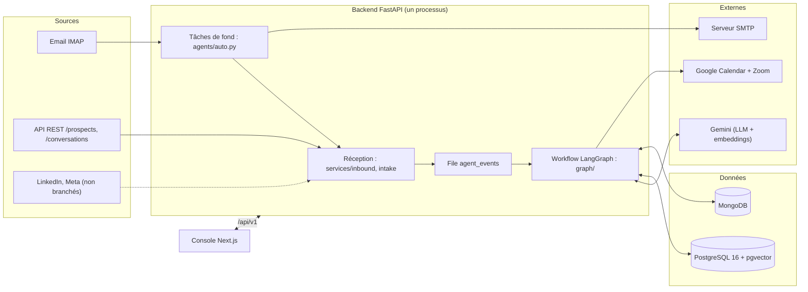

# Architecture

Vue d'ensemble technique du projet. Le détail de chaque module est dans les pages dédiées
(voir le [sommaire](README.md)).

## En une phrase

Des messages de prospects arrivent (email, API REST), le backend FastAPI les range dans PostgreSQL et
MongoDB, un workflow LangGraph les analyse et prépare une réponse, et un conseiller valide le tout
depuis une console Next.js.

## Couches du backend

| Dossier | Rôle | Dépend de |
|---|---|---|
| `app/api/v1/` | Routes HTTP, validation des entrées, droits | `services`, `schemas` |
| `app/services/` | Logique métier : prospects, conversations, scoring, relances, email, brouillons… | `models`, `database`, `integrations` |
| `app/graph/` | Workflow de l'agent : état, nœuds, règles de décision, consignes | **uniquement** `graph/ports.py` |
| `app/agents/` | Exécution du workflow (verrou, trace), passerelle vers les données, tâches de fond | `graph`, `services` |
| `app/integrations/` | Adaptateurs vers l'extérieur : LLM, embeddings, email, agenda, base de connaissances | SDK et bibliothèques |
| `app/models/`, `app/schemas/` | Tables SQLAlchemy, schémas Pydantic | — |
| `app/devtools/` | Données fictives, simulateur, scénarios de recette (jamais en production) | tout |

Règle d'architecture (NF-01, NF-02, rappelée dans `AGENTS.md`) : `app/graph` et `app/agents` n'importent
**aucun** SDK de plateforme. Tout passe par les ports.

## Ports et adaptateurs

Le graphe ne connaît que des interfaces (`app/graph/ports.py`). Chaque service réel est un adaptateur
choisi par configuration dans une fabrique (`factory.py`).

| Port | Rôle | Adaptateurs disponibles | Choix |
|---|---|---|---|
| `LanguageModel` | `generate` (texte) et `extract` (sortie structurée) | Gemini, OpenAI via LangChain, avec nouveaux essais (`llm/resilient.py`) | `LLM_PROVIDER`, `LLM_MODEL` |
| `KnowledgeBase` | Recherche d'extraits validés | pgvector (`knowledge/pg_knowledge.py`) ; vide sans clé d'embeddings | `EMBEDDING_PROVIDER` |
| `Calendar` | Créneaux libres et réservation | Google Calendar + Zoom, démo, « non configuré » | `CALENDAR_PROVIDER` |
| `Messenger` | Enregistrer la réponse de l'agent | `RecordingMessenger` : écrit dans la conversation ; l'envoi réel est fait ensuite par le worker email | — |
| `Gateway` | Lire et écrire les données métier | `agents/gateway.py::DbGateway` (PostgreSQL + MongoDB) | — |

Conséquence pratique : les tests et le simulateur remplacent ces ports par des doublures
(`devtools/fakes.py`, `tests/fakes.py`) et rejouent tout le parcours sans réseau.

## Parcours d'un message entrant

1. **Réception.** Un email (relève IMAP) ou un appel REST crée ou retrouve le prospect (déduplication
   sur email, téléphone, identifiants réseaux), puis ajoute le message à sa conversation MongoDB.
   L'identifiant externe (`Message-ID`, `external_message_id`) rend l'opération rejouable sans doublon.
2. **STOP d'abord.** `services/inbound.py` détecte une demande d'arrêt **sans modèle** et désinscrit le
   prospect avant toute autre action.
3. **Mise en file.** Une demande persistante `agent_events` est créée (une par conversation et message).
4. **Exécution de l'agent.** Le worker `reply_queue_loop` la reprend, prend un bail MongoDB sur la
   conversation, puis lance le graphe : chargement du contexte → identification → enrichissement →
   qualification (LLM) → score (règles) → décision (règles) → action.
5. **Résultat.** Selon le mode : brouillon à valider (assisté), message prêt à partir (auto) ou rien
   (manuel). Chaque exécution est tracée (`agent_runs`) avec ses nœuds, sa décision et sa justification.
6. **Envoi.** Le worker email envoie les messages `not_sent` après avoir relu consentement, mode et bac à
   sable. Cycle : `not_sent → sending → sent | failed | blocked`.

Détail des règles : [agent-workflow.md](agent-workflow.md). Détail de la réception : [intake.md](intake.md).

## Tâches de fond

Lancées au démarrage de l'API (`app/main.py`), dans le **même processus** :

| Boucle | Rôle | Réglage |
|---|---|---|
| `reply_queue_loop` | Traite les demandes `agent_events` (50 par passage, toutes les 10 s) | `AGENT_AUTO_REPLY` |
| `follow_up_loop` | Exécute les relances échues dans la fenêtre d'envoi | `FOLLOW_UP_WORKER_ENABLED`, `FOLLOW_UP_INTERVAL_SECONDS` |
| `email_loop` | Relève la boîte et envoie les messages validés | Console « Intégrations » ou `EMAIL_*`, `EMAIL_POLL_SECONDS` |

Un **bail MongoDB** (`services/lease.py`) garantit qu'une seule instance exécute chaque boucle et chaque
conversation. Recommandation actuelle : un seul processus API (`--workers 1`).

## Données

| Base | Contenu | Pourquoi |
|---|---|---|
| PostgreSQL 16 + pgvector | Prospects, consentements, campagnes, sources, rattachements, scores, étapes, relances, rendez-vous, comptes, base de connaissances et ses vecteurs | Données reliées, contraintes d'unicité, transactions, recherche vectorielle |
| MongoDB | Conversations (messages embarqués), exécutions de l'agent, réglages globaux, baux, file `agent_events` | Documents qui grossissent, schéma souple, opérations atomiques |
| Redis | Déclaré dans `docker-compose.yml`, utilisé seulement par le contrôle de santé | Prévu pour un compteur partagé ; absent du compose de production |

Le contenu d'un message n'existe qu'à un endroit (MongoDB) ; PostgreSQL garde un journal `interactions`
avec une référence `conversation_ref`. Il n'y a pas de transaction entre les deux bases : les opérations
sont idempotentes et un rejeu répare un journal manquant. Voir [database/README.md](database/README.md).

Migrations : Alembic (`backend/alembic/versions/`, 0001 à 0009), appliquées au démarrage en Docker.

## Frontend

Next.js 15 (App Router, TypeScript), dans `frontend/src/` :

- `app/` : une route par écran (`/`, `/todo`, `/conversations`, `/prospects`, `/campaigns`, `/knowledge`,
  `/integrations`, `/simulator`, `/login`) ;
- `lib/api.ts`, `lib/useApi.ts` : appels à l'API avec le jeton ;
- `components/` : cadre commun (`AppShell`), vues de conversation, trace de l'agent, formulaires.

Le jeton est conservé dans `localStorage` (à remplacer par un cookie `HttpOnly` avant une exposition
publique). Le simulateur se désactive au build avec `NEXT_PUBLIC_ENABLE_SIMULATOR=false`.

## Sécurité

- Authentification JWT, mots de passe argon2, rôles ADMIN / ADVISOR / VIEWER relus en base à chaque requête.
- Limitation des connexions : 5 échecs en 15 minutes par adresse et identifiant (en mémoire).
- En `ENVIRONMENT=production`, l'application refuse de démarrer avec un secret JWT faible, `DEBUG` actif
  ou un CORS ouvert ; `/docs` et `/openapi.json` sont coupés ; les outils de démo sont refusés.
- Les identifiants saisis dans la console (boîte email) sont chiffrés avec `CONNECTORS_SECRET_KEY`.

## Configuration et environnements

Toute la configuration passe par des variables d'environnement (`app/config.py`, modèle `.env.example`).

| Environnement | Lancement | Particularités |
|---|---|---|
| Local | `docker compose up` + `npm run dev` | Bases exposées en local, simulateur actif |
| `dev` (serveur) | `deploy/deploy.sh dev`, automatique après CI verte | `ENVIRONMENT=development`, simulateur actif |
| `prod` (serveur) | `deploy/deploy.sh <branche>`, manuel | `ENVIRONMENT=production`, simulateur absent |

Détails : [deploiement.md](deploiement.md).

## Qualité

- Backend : `ruff`, `mypy` strict, `pytest` (≈ 390 tests, couverture minimale 70 %), sur SQLite et
  mongomock en local, sur PostgreSQL et MongoDB réels en CI.
- Frontend : ESLint, `tsc`, build, tests Playwright avec API simulée.
- Workflow n8n : tests hors ligne (`node --test tools/n8n/prospect.test.mjs`).
- CI : `.github/workflows/ci.yml` ; déploiement de `dev` : `.github/workflows/deploy-dev.yml`.
