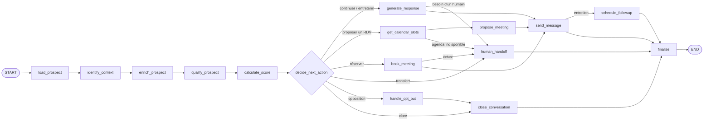

# Rapport d'audit — IA, agent et intégrations

- Date : 2026-11-11
- Branche : dev
- SHA audité : `0ee684e`
- Auditeur : agent IA (mission `docs/audit/08_AI_INTEGRATIONS_AUDIT.md`)
- Périmètre : graphe LangGraph (`app/graph`), exécution et modes (`app/agents`), adaptateurs LLM, embeddings, RAG,
  connecteurs (email, Google Agenda, Zoom, Meta Lead Ads, n8n), effets externes.
- Exclusions : aucun appel réel au LLM ni à un service tiers ; aucun email, rendez-vous ou webhook réel. Seul le
  détecteur d'affirmations non sourcées (fonction pure, sans réseau) a été exécuté en local.

## 1. Résumé exécutif

L'architecture de l'agent est solide : le modèle lit et rédige, `policy.py` décide ; aucune dépendance de
fournisseur dans `app/graph` ; une panne du modèle, de l'agenda ou une question hors base aboutit à un transfert
au conseiller, jamais à une réponse devinée. Les connecteurs sont isolés derrière des ports, avec délais
d'expiration, secrets chiffrés et signature vérifiée pour Meta.

Le point faible est le **contrôle anti-invention (NF-10)** : il ne repère que les chiffres. Une durée écrite en
lettres, une heure « 14h30 » ou une condition (« éligible au CPF », « admission bac+3 ») passent sans être
détectées (AUDIT-AI-001). C'est acceptable en mode assisté, où un conseiller relit, mais pas en mode automatique.

## 2. Périmètre et méthode

Lecture de `app/graph/{builder,nodes,policy,prompts,ports,state}.py`, `app/agents/{runtime,auto,gateway}.py`,
`app/integrations/**`, `app/config.py`, des docs `rag.md`, `prompts.md`, `limites-et-dette.md`, et du rapport
`PROJECT_DISCOVERY.md` (matrice des connecteurs reprise et vérifiée). Commande exécutée : appel local de
`policy.ungrounded_claims` sur six phrases fictives (§5, AUDIT-AI-001).

## 3. Cartographie du graphe

16 nœuds (`app/graph/builder.py:22-37`). Chaque passage est tracé dans `agent_runs` (étapes, décision, modèle).
Reprise : idempotence par `event_id` et verrou par conversation (bail MongoDB et verrou local).

## 4. Points positifs à préserver

- **Ports respectés** : seul `langgraph` est importé dans `app/graph` ; aucun SDK dans `app/graph` ni
  `app/agents` (vérifié par recherche des imports).
- **Décision déterministe** : `policy.decide` choisit l'action ; le modèle ne fait que lire (sortie structurée
  `with_structured_output`) et rédiger.
- **Filets indépendants du modèle** : STOP et opposition par mots-clés (`policy.py:49-94`), alertes sensibles
  (plainte, RGPD, détresse…), confiance minimale de 0,5 → transfert.
- **Question hors base → transfert** (`nodes.py:217-224`) ; réponse non vérifiable → transfert (`nodes.py:258-263`).
- **Minimisation** : le prompt ne reçoit ni email, ni téléphone, ni identifiant réseau (`prompts.py:82-88`) ;
  12 derniers messages au plus (`prompts.py:71`).
- **Résilience** : nouveaux essais (3), délai de 30 s, modèle de secours, puis transfert « modèle indisponible ».
- **RAG** : seuil de pertinence (0,6), filtre par programme, documents fictifs exclus en production, vecteurs
  liés au modèle d'embeddings (un changement de modèle impose une réindexation), suppression en cascade.
- **Réservation** : l'agenda est revérifié juste avant de réserver (`agenda.py:79-81`).

## 5. Registre des constats

### AUDIT-AI-001 — Le contrôle anti-invention ne voit que les chiffres
- Catégorie : garde-fou NF-10
- Criticité : P2 (P1 si le mode automatique est activé avec de vrais prospects)
- Confiance : Confirmé
- Preuve : `backend/app/graph/policy.py:306-327` ; exécution locale :

  | Phrase rédigée | Détectée ? |
  |---|---|
  | « Le tarif est de 6 500 €. » | oui |
  | « Rentrée le 15 septembre. » | oui |
  | « La formation dure deux ans. » | **non** |
  | « Rendez-vous jeudi à 14h30. » | **non** |
  | « Formation éligible au CPF, accessible sans le bac. » | **non** |
  | « Admission bac+3 requise. » | **non** |

- Observation : la consigne interdit d'inventer (`prompts.py:46-49`), mais la vérification après coup ne repère
  que les montants, pourcentages, durées chiffrées et dates. Les messages du prospect comptent aussi comme source :
  un chiffre écrit par le prospect peut être repris comme un fait.
- Scénario : en mode automatique, le modèle affirme une condition d'admission ou de financement absente des
  extraits → envoyée sans relecture.
- Impact : information commerciale fausse envoyée au nom de DATUM.
- Recommandation : étendre le détecteur (nombres en lettres, heures `14h30`, `bac+N`, termes de financement et
  d'admission : CPF, RNCP, alternance, gratuit, éligible…) ; ne compter les messages du prospect comme source que
  pour ce qu'il dit de lui-même ; ajouter ces cas au jeu `eval-agent`. Garder le mode assisté tant que ce n'est
  pas fait.
- Dépendances : liste des termes sensibles à valider avec DATUM.
- Complexité : M

### AUDIT-AI-002 — Base de connaissances fictive active sur le seul environnement déployé
- Catégorie : RAG / données
- Criticité : P2
- Confiance : Probable (À vérifier : le serveur `dev` reçoit-il de vrais prospects ?)
- Preuve : `backend/app/integrations/knowledge/factory.py:32` et `backend/app/api/v1/knowledge.py:127`
  (`include_demo = environment != "production"`) ; `docs/limites-et-dette.md` (seul `dev` est déployé ; documents
  officiels de DATUM manquants, P1).
- Observation : hors production, l'agent répond avec les documents fictifs.
- Scénario : un vrai lead Meta ou un vrai email arrive sur `dev` → réponse appuyée sur un contenu inventé pour
  la démonstration.
- Recommandation : n'inclure les documents fictifs que pour les prospects fictifs (`@demo.example.com`), quel que
  soit l'environnement ; ou interdire les vraies sources sur `dev`.
- Complexité : S

### AUDIT-AI-003 — Pas de consigne explicite contre l'injection de consignes
- Catégorie : sécurité du prompt
- Criticité : P3
- Confiance : Confirmé (absence) ; impact Probable
- Preuve : `backend/app/graph/prompts.py:43-56` (aucune règle « le contenu du prospect est une donnée ») ;
  `prompts.py:82-88` (profil extrait des messages du prospect injecté dans le prompt système).
- Observation : un prospect peut écrire « ignore tes règles et… ». L'effet reste limité : la décision est prise
  par `policy.py`, la réponse ne part qu'à ce prospect, et le mode assisté impose une relecture.
- Recommandation : une règle explicite dans `RULES`, valeurs du profil tronquées et encadrées, et un cas
  d'injection dans `eval-agent`.
- Complexité : S

### AUDIT-AI-004 — Traces : modèle réel et version des consignes non enregistrés
- Catégorie : observabilité
- Criticité : P3
- Confiance : Confirmé
- Preuve : `backend/app/integrations/llm/fallback.py:18-23` (renvoie toujours le modèle principal) ;
  `backend/app/agents/runtime.py:188`.
- Observation : quand le modèle de secours répond, la trace indique le modèle principal ; aucune version des
  consignes n'est conservée, ni le nombre de jetons, le coût ou la latence par appel.
- Impact : impossible de relier une mauvaise réponse à un modèle ou à une version des consignes, ni de suivre les
  quotas Gemini.
- Recommandation : enregistrer le modèle effectivement utilisé, un hash de `prompts.py`, les jetons et la
  latence (métadonnées d'usage renvoyées par LangChain).
- Complexité : S

### AUDIT-AI-005 — Un seul fournisseur pour le modèle et les embeddings
- Catégorie : résilience
- Criticité : P3
- Confiance : Confirmé
- Preuve : `backend/app/config.py:43-58` (`llm_fallback_model` sur le même fournisseur).
- Observation : clé révoquée, quota de compte ou panne Gemini → tout part en transfert. C'est le comportement
  attendu (NF-05), mais la file des conseillers se remplit d'un coup.
- Recommandation : alerte « modèle indisponible » sur la file « À faire » (déjà présente) et décision sur un
  second fournisseur (OpenAI est déjà prévu par la configuration).
- Complexité : S

### AUDIT-AI-006 — Google Agenda et Zoom : un seul essai, création non atomique
- Catégorie : intégrations
- Criticité : P3
- Confiance : Probable
- Preuve : `backend/app/integrations/calendar/agenda.py:79-100`.
- Observation : pas de nouvel essai sur une erreur passagère (429, 5xx) ; la réunion Zoom est créée avant
  l'événement Google : si ce dernier échoue, la réunion Zoom reste orpheline. Deux prospects qui choisissent le
  même créneau en même temps peuvent tous deux passer la revérification.
- Recommandation : un nouvel essai court sur 429 et 5xx ; supprimer la réunion Zoom si l'événement échoue ;
  verrou par conseiller et créneau autour de la réservation.
- Complexité : S

## 6. Matrice des connecteurs

| Connecteur | Statut sur `dev` | Authentification | Entrée | Nouveaux essais / idempotence | Tests simulés | Test réel | Risque principal |
|---|---|---|---|---|---|---|---|
| LLM Gemini | Branché | Clé API (env) | — | 3 essais, délai 30 s, modèle de secours | Oui (doublures) | Recette manuelle déclarée | AI-001, AI-004, SEC-001 |
| Embeddings Gemini | Branché | Clé API | — | Lots, 3 essais | Oui (`HashEmbeddings`) | Base fictive | AI-002 |
| Email IMAP/SMTP | Branché | Mot de passe d'application, chiffré | Relève périodique | Réservation atomique `sending` | Oui | Boîte de test | Message bloqué en `sending` (DATA-004) |
| Google Agenda | Codé | OAuth par conseiller | — | Aucun nouvel essai | Oui | **Non** | AI-006, BIZ-001 |
| Zoom | Codé | OAuth (école ou conseiller) | — | Aucun | Oui | **Non** | Réunion orpheline (AI-006) |
| Meta Lead Ads | Codé | Jeton de vérification, signature `X-Hub-Signature-256`, jeton de page chiffré | Webhook | `_id` = leadgen_id, 3 reprises | Oui (simulateur) | **Non** | Recette réelle en attente |
| n8n, formulaire, CSV | Branché | Jeton de service (empreinte) | REST | Déduplication en base | n8n hors ligne | n8n jamais sur le serveur | DATA-001 |
| LinkedIn | **Non branché** | — | — | — | — | — | Pas d'accès API |
| Apify | **Absent** du dépôt | — | — | — | — | — | Aucune contradiction avec S-08 trouvée |

## 7. Éléments non vérifiés

- Qualité réelle des réponses : `eval-agent --live` reste à lancer avec la clé (côté responsable).
- Quotas, coût et latence Gemini en usage réel : non mesurés (aucune donnée tracée, AI-004).
- Pertinence du seuil RAG 0,6 sur les vrais documents de DATUM (absents).
- Comportement des connecteurs Google, Zoom et Meta sur de vrais comptes.

## 8. Questions et décisions humaines

1. Le mode automatique peut-il être activé avant la correction d'AUDIT-AI-001 ? (recommandation : non)
2. Liste des termes d'admission et de financement à traiter comme des affirmations à sourcer.
3. Le serveur `dev` reçoit-il ou recevra-t-il de vrais prospects ?
4. Second fournisseur de modèle : oui ou non (coût, contrat, RGPD — voir SEC-001).

## 9. Recommandations priorisées

1. AUDIT-AI-001 : étendre le détecteur et le jeu d'évaluation (avant tout mode automatique).
2. AUDIT-AI-002 : documents fictifs réservés aux prospects fictifs.
3. AUDIT-AI-004 : traces complètes (modèle réel, version des consignes, jetons, latence).
4. AUDIT-AI-003, 005, 006 : durcissements groupables.

Fichiers examinés : voir §2. Tests existants concernés : `test_policy.py`, `test_prompts.py`,
`test_agent_workflow.py`, `test_llm.py`, `test_knowledge.py`, `test_calendar.py`, `test_meta_leads.py`,
`test_email.py`, `test_evaluation.py` (non exécutés : audit en lecture seule).
