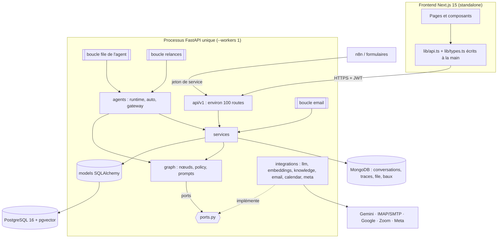

# Rapport d'audit — Architecture

- Date : 2026-11-11
- Branche : dev
- SHA audité : `0d7eded`
- Auditeur : agent IA (mission `docs/audit/02_ARCHITECTURE_AUDIT.md`)
- Périmètre : couches du backend, graphe et ports, modèle d'exécution, frontières frontend / API / bases,
  séparation des environnements.
- Exclusions : performances mesurées (mission 10) ; aucun service démarré.

## 1. Résumé exécutif

L'architecture est adaptée au MVP et ne demande pas de refonte. Elle est organisée ainsi :
- un monolithe FastAPI en couches (API → services → modèles), avec un graphe LangGraph isolé derrière des
  ports ;
- des adaptateurs pour chaque fournisseur ;
- deux bases aux rôles nets : PostgreSQL pour le relationnel, MongoDB pour les conversations et les traces.

La règle NF-01/NF-02 est respectée : aucun SDK de plateforme dans `app/graph` ni `app/agents`.

Les risques tiennent à des **hypothèses implicites** plutôt qu'à des défauts de structure :
- le processus unique (`--workers 1`) n'est imposé que par la configuration (ARCH-002) ;
- les types du frontend sont recopiés à la main depuis l'API, sans vérification automatique (ARCH-003).

Aucun P0 ni P1.

## 2. Périmètre et méthode

Mesure des modules par couche ; analyse des imports de niveau module de `backend/app` par un script AST (sens
des dépendances, cycles) ; lecture de `main.py`, `api/dependencies.py`, `agents/runtime.py`, `services/lease.py`,
`config.py`, `deploy/compose.prod.yml`, `docs/decisions.md`. Aucune application démarrée.

## 3. Cartographie

| Couche | Lignes | Rôle |
|---|---|---|
| `api` | 2 821 | routes, dépendances, rôles |
| `services` | 6 248 | logique métier, accès aux données |
| `graph` | 1 540 | orchestration de l'agent, sans fournisseur |
| `agents` | 1 013 | exécution, déclencheurs, passerelle vers les données |
| `integrations` | 2 089 | adaptateurs des fournisseurs |
| `schemas` / `models` | 1 373 / 660 | contrats Pydantic / tables |
| `devtools` | 2 747 | outils de recette (refusés en production) |

Plus gros modules : `devtools/evaluation.py` (740 lignes), `services/prospects.py` (581), `graph/nodes.py` (546),
`services/email_sync.py` (540). Ce sont des tailles raisonnables, avec une seule responsabilité chacun.

## 4. Points positifs à préserver

- **Ports et adaptateurs** : `app/graph` n'importe que `langgraph` et les énumérations des modèles ; les
  fournisseurs sont injectés par `Deps` (`graph/builder.py`) et construits par des factories
  (`integrations/*/factory.py`).
- **Testabilité** : doublures pour le modèle, l'agenda, les embeddings (`tests/fakes.py`, `HashEmbeddings`) ;
  SQLite et mongomock en local, vrais moteurs en CI.
- **Erreurs typées** : `ServiceError` → 404 / 409 / 422 (`api/errors.py`), erreurs des ports
  (`LLMError`, `CalendarError`) converties en transfert au conseiller.
- **Exécution prudente** : bail MongoDB par conversation et par boucle (`services/lease.py`), appels IMAP/SMTP
  bloquants déportés dans des threads (`asyncio.to_thread`), décision D-08 documentée.
- **Environnements** : outils de recette, simulateur et purge de démo refusés en production ; OpenAPI masqué en
  production (`main.py:61`) ; le modèle `.env.production.example` fixe `ENVIRONMENT=production`.
- **Pas de sur-ingénierie** : pas de bus d'événements ni de microservices ; la file `agent_events` dans MongoDB
  suffit au volume attendu.

## 5. Registre des constats

### AUDIT-ARCH-001 — Dépendances à contre-sens entre couches
- Catégorie : couplage
- Criticité : P3
- Confiance : Confirmé
- Preuve :
  - `services/todo.py:16` et `services/analytics.py:14` (importent `agents.runtime.RUNS`) ;
  - `services/agenda.py:18` (importe `agents.defaults`) ;
  - `schemas/prospect.py:8` et `schemas/todo.py:7` (importent des services) ;
  - cycle d'imports `services.conversations` → `drafts` → `inbound`.
- Impact : faible aujourd'hui. Ces dépendances rendent les déplacements de code plus risqués (import circulaire au
  démarrage).
- Recommandation : déplacer les noms de collections MongoDB et les constantes partagées dans un module neutre
  (ex. `app/database/collections.py`), et `AgentMode` / `is_demo_email` dans `schemas` ou `core`.
- Complexité : S

### AUDIT-ARCH-002 — Le processus unique est une hypothèse non vérifiée au démarrage
- Catégorie : modèle d'exécution
- Criticité : P3
- Confiance : Confirmé
- Preuve : `deploy/compose.prod.yml:103-104` (`--workers 1`) ; `agents/runtime.py:69,91-94` (verrou local
  par conversation, en plus du bail) ; `main.py:33-39` (trois boucles par processus) ; D-08.
- Observation : passer à `--workers 2` multiplie les boucles. Le bail MongoDB évite les doubles traitements,
  mais les verrous locaux ne protègent plus rien et les relances sont réclamées en concurrence (sans dégât, grâce
  à la réservation atomique). Le dictionnaire `_locks` garde un verrou par conversation sans jamais le libérer.
- Recommandation : garder un seul processus ; ajouter un réglage « boucles actives » pour qu'un éventuel second
  processus ne serve que le HTTP. Libérer les verrous inutilisés (`WeakValueDictionary` ou suppression en fin
  d'exécution). Un worker dédié seulement si la charge le montre.
- Complexité : S

### AUDIT-ARCH-003 — Contrat frontend / API recopié à la main, sans vérification
- Catégorie : contrats
- Criticité : P2
- Confiance : Confirmé
- Preuve : `frontend/src/lib/types.ts` (580 lignes écrites à la main) ; les tests Playwright simulent l'API
  (16 fichiers avec `page.route`) ; `docs/limites-et-dette.md` (tests navigateur sur API simulée).
- Scénario : un champ renommé dans un schéma Pydantic passe la CI backend (ses tests) et la CI frontend (API
  simulée) ; l'écran casse seulement sur le serveur.
- Recommandation : générer les types depuis `/openapi.json` (ex. `openapi-typescript`) dans un script, et vérifier
  en CI que le fichier généré est à jour. Migrer `types.ts` progressivement.
- Complexité : M

### AUDIT-ARCH-004 — Environnement « development » par défaut
- Catégorie : séparation des environnements
- Criticité : P3
- Confiance : Confirmé
- Preuve : `backend/app/config.py:26` (`environment = "development"` par défaut) ; effets :
  - documentation OpenAPI publiée ;
  - documents fictifs dans le RAG (AUDIT-AI-002) ;
  - simulateur et purge de démo autorisés.
- Observation : un `.env` de production sans `ENVIRONMENT` démarre en mode d'essai sans alerte (le modèle de
  `.env` le fixe bien, mais rien ne le vérifie).
- Recommandation : rendre `ENVIRONMENT` obligatoire hors tests, ou signaler au démarrage le mode actif quand des
  sources réelles (Meta, boîte mail) sont configurées.
- Complexité : S

Constats liés : Redis présent seulement pour le contrôle de santé (AUDIT-DATA-009) ; base de connaissances fictive
hors production (AUDIT-AI-002).

## 6. Éléments non vérifiés

- Imports faits à l'intérieur des fonctions (non pris en compte par l'analyse des cycles).
- Comportement réel avec plusieurs processus (non exécuté).

## 7. Questions et décisions humaines

1. D-08 « à revoir » : quel volume justifierait un worker séparé (messages par jour, nombre de conseillers) ?
2. Accepter l'ajout d'une étape de génération de types côté frontend (ARCH-003) ?

## 8. Recommandations priorisées

1. ARCH-003 : types générés depuis OpenAPI et vérifiés en CI.
2. ARCH-004 : `ENVIRONMENT` obligatoire.
3. ARCH-001 et ARCH-002 : nettoyage, à faire lors d'une modification voisine.

## 9. Fichiers examinés

`backend/app/**` (analyse des imports), `backend/app/main.py`, `config.py`, `agents/runtime.py`,
`services/lease.py`, `api/errors.py`, `deploy/compose.prod.yml`, `deploy/.env.production.example`,
`docs/decisions.md`, `frontend/src/lib/{api,types}.ts`, `frontend/tests/`.
