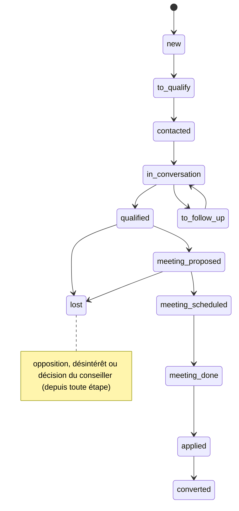

# Rapport d'audit — Logique métier et processus commercial

- Date : 2026-11-11
- Branche : dev
- SHA audité : `0ee684e`
- Auditeur : agent IA (mission `docs/audit/07_BUSINESS_LOGIC_AUDIT.md`)
- Périmètre : prospects, sources et campagnes, attribution, score et étapes, conversations et brouillons, modes,
  opposition, relances, rendez-vous, démo, effacement.
- Exclusions : aucun parcours exécuté sur une base réelle ; aucun effet externe. Les règles sont lues dans les docs
  (`agent-workflow`, `intake`, `advisor-workflow`, `campaign-ownership`, `follow-ups`, `sources-leads`,
  `effacement-rgpd`, `demo-mode`, `limites-et-dette`) et comparées au code.

## 1. Résumé exécutif

Les invariants principaux sont tenus et testés : aucun message ne part vers un prospect opposé, quelle que soit
l'entrée ou la sortie ; une relance s'arrête dès qu'il répond, change d'étape ou s'oppose ; les étapes ne
reculent pas sans action humaine ; l'effacement couvre les deux bases. Le backend compte 518 fonctions de test.

Deux défauts logiciels méritent une correction rapide, tous deux sur les rendez-vous : un créneau **déjà passé**
peut être réservé (AUDIT-BIZ-001), et un rendez-vous peut être pris dans l'agenda d'un **conseiller désactivé**
(AUDIT-BIZ-002). Le reste relève surtout de **règles non décidées** par DATUM (seuils, fuseau horaire du prospect,
réactivation après opposition).

## 2. Périmètre et méthode

Lecture des services (`prospects`, `pipeline`, `scoring`, `follow_ups`, `campaign_ownership`, `users`,
`conversations`, `inbound`, `email_sync`, `erasure`, `demo`), de `app/graph/policy.py`, `app/agents/{auto,gateway}.py`,
`app/integrations/calendar/agenda.py` et des fichiers de tests. Aucun test exécuté.

## 3. Cycles de vie

**Étape de conversion** (l'agent ne la fait qu'avancer ; un conseiller peut la corriger) :

12 étapes (`backend/app/models/enums.py:26-38`). Le diagramme montre le chemin principal, pas toutes les
transitions permises.

**Niveau d'intérêt** (froid ≤ 24, tiède, chaud ≥ 50 avec qualification complète → proposition de rendez-vous) :
indépendant de l'étape, recalculé à chaque message, chaque variation tracée dans `score_events`.

## 4. Matrice règle → implémentation → tests → écart

| Règle | Implémentation | Tests | Écart |
|---|---|---|---|
| Un prospect unique par identifiant (F-05) | unicité en base, `IntegrityError` rattrapée (`prospects.py:195,307,478`) | `test_prospects_api` | téléphone sans format international (DATA-001) ; pas de fusion (connu) |
| Un prospect, plusieurs campagnes, historique des apparitions (F-03) | `campaign_prospects` unique (source, prospect), `first_seen_at` / `last_seen_at` | `test_campaigns_api`, `test_intake_context` | — |
| Responsable de campagne, exceptions individuelles | `campaign_ownership.py`, verrou de campagne | `test_campaign_ownership*` | conseiller désactivé encore utilisé pour les rendez-vous (BIZ-002) |
| Étape et intérêt distincts ; pas de recul automatique | `policy.stage_for`, `_forward` (`policy.py:250-290`) | `test_policy`, `test_pipeline_api`, `test_scoring` | seuils non validés par DATUM |
| Correction humaine du score et de l'étape, tracée | `pipeline.py`, `scoring.py`, `stage_events`, `score_events` | `test_pipeline_api`, `test_scoring` | — |
| Question hors base → transfert (F-20) | `nodes.py:217-224` | `test_agent_workflow` | — |
| Validation concurrente d'un brouillon | réservation conditionnelle du brouillon (`drafts.py:79`) puis de l'envoi | `test_email.py:492`, `test_review_safeguards` | — |
| Modes assisté / automatique / manuel, arrêt d'urgence | réglages, `auto.py`, `RecordingMessenger` | `test_auto_agent`, `test_assisted_mode`, `test_lot1_safety` | mode automatique : voir AI-001 |
| STOP et opposition à toutes les entrées | mots-clés + intention du modèle (`nodes.py:117`, `inbound.py:30`, `email_sync.py:184-196`) | `test_policy`, `test_email`, `test_lot1_safety` | faux positifs possibles (BIZ-004) |
| Aucun envoi vers un prospect opposé | `conversations.py:258`, `auto.py:89,231`, `email_sync.py:357` | `test_lot1_safety`, `test_email` | — |
| Une nouvelle source ne réactive pas un opposé | `prospects.py:244` | `test_prospects_api`, `test_lot1_safety` (à confirmer) | — |
| Relances : fenêtre, plafond, arrêt après réponse / étape / opposition, idempotence | `auto.py:194-285`, `follow_ups.cancel_*`, réservation atomique | `test_auto_agent` (dont `:171`, travailleurs concurrents) | erreur technique retentée sans plafond (BIZ-005) ; fuseau fixe (BIZ-003) |
| Rendez-vous sur disponibilité réelle | revérification avant réservation (`agenda.py:79-81`) | `test_calendar`, `test_appointments` | créneau passé réservable (BIZ-001) ; course entre deux prospects (AI-006) |
| Démo : marquage, filtres, purge, aucun effet externe | `demo.py`, `agent_commands.py:123`, `auto.py:218` | `test_demo`, `test_devtools`, `test_simulation` | repérage par email seulement (DATA-007) |
| Effacement RGPD propagé | `erasure.py:87-155` | `test_erasure` | emails de la boîte et événements Google / Zoom à supprimer à la main (connu) |
| Plusieurs emails rapprochés → une seule réponse | — | — | chacun reçoit une réponse (connu, `limites-et-dette.md`) |

## 5. Registre des constats

### AUDIT-BIZ-001 — Un créneau déjà passé peut être réservé
- Catégorie : défaut logiciel (rendez-vous)
- Criticité : P2
- Confiance : Confirmé (lecture du code) ; aucun test ne couvre le cas
- Preuve : `backend/app/agents/gateway.py:51-69` (créneaux proposés relus sans contrôle de date) ;
  `backend/app/graph/policy.py:205-209` ; `backend/app/integrations/calendar/agenda.py:79-81` (la
  revérification ne regarde que l'occupation).
- Scénario : l'agent propose lundi 10 h ; le prospect répond « le 1 » mercredi → l'agenda est libre dans le
  passé, l'événement est créé et le prospect reçoit « C'est noté : rendez-vous lundi … à 10h ».
- Impact : rendez-vous fantôme, prospect perdu, étape « rendez-vous » comptée à tort.
- Recommandation : ignorer les créneaux dont le début est passé (ou trop proche) et reproposer ; ajouter un test.
- Complexité : S

### AUDIT-BIZ-002 — Rendez-vous possible chez un conseiller désactivé
- Catégorie : défaut logiciel (attribution)
- Criticité : P2
- Confiance : Probable
- Preuve : `backend/app/agents/gateway.py:102-123` (conseiller affecté utilisé sans vérifier `is_active`) ;
  `backend/app/services/users.py:84-100` (la désactivation ne touche pas aux affectations, comme le veut
  `docs/campaign-ownership.md:36-39`).
- Scénario : un conseiller quitte l'équipe et son compte est désactivé ; ses prospects affectés continuent de
  recevoir des créneaux pris dans son agenda.
- Impact : rendez-vous sans personne pour l'assurer.
- Recommandation : traiter un conseiller inactif comme « non affecté » pour l'agenda (agenda par défaut ou
  transfert) et le signaler dans « À faire ».
- Complexité : S

### AUDIT-BIZ-003 — Fuseau horaire fixe (Paris) malgré un réglage d'agenda modifiable
- Catégorie : règle non décidée
- Criticité : P3
- Confiance : Confirmé
- Preuve : `backend/app/graph/prompts.py:14` et `backend/app/agents/auto.py:44` (`Europe/Paris` en dur) ;
  `backend/app/schemas/runtime_settings.py:30` (`calendar_timezone` réglable).
- Observation : les créneaux sont annoncés en heure de Paris, sans le préciser, et la fenêtre des relances
  (8 h – 19 h) est calculée à Paris, même si l'agenda est réglé autrement. Le fuseau du prospect n'est pas connu.
- Recommandation : utiliser `calendar_timezone` partout, préciser le fuseau dans le message ; décider si le
  fuseau du prospect doit être demandé.
- Complexité : S

### AUDIT-BIZ-004 — Opposition par mots-clés : faux positifs possibles
- Catégorie : règle à arbitrer
- Criticité : P3
- Confiance : Probable
- Preuve : `backend/app/graph/policy.py:49-59` (`desinscri`, `\bstop\b`).
- Scénario : « Comment me désinscrire de mon école actuelle pour m'inscrire chez vous ? » → opposition
  enregistrée, conversation close.
- Observation : le choix « mieux vaut trop que pas assez » est défendable ; un conseiller peut rétablir le
  consentement (`prospects.py:116`), mais rien ne signale ces cas.
- Recommandation : garder le filet ; signaler dans « À faire » une opposition par mot-clé quand le modèle lisait
  une autre intention, pour vérification.
- Complexité : S

### AUDIT-BIZ-005 — Relance en erreur technique retentée sans limite
- Catégorie : défaut logiciel (robustesse)
- Criticité : P3
- Confiance : Confirmé
- Preuve : `backend/app/agents/auto.py:275-280` (libérée puis reprise au cycle suivant, sans compteur).
- Scénario : une erreur persistante sur un prospect → nouvel essai et trace d'erreur à chaque cycle.
- Recommandation : compteur d'essais ; au-delà de 3, annuler avec un motif visible.
- Complexité : S

Constats liés, déjà décrits ailleurs : téléphone (AUDIT-DATA-001), démo par email (AUDIT-DATA-007), anti-invention
(AUDIT-AI-001), réservation concurrente (AUDIT-AI-006), données envoyées au LLM (SEC-001).

## 6. Scénarios limites vérifiés

| Scénario | Résultat attendu | Code |
|---|---|---|
| Prospect opposé reçoit une relance programmée | relance annulée | `auto.py:231-234` |
| Prospect répond pendant qu'une relance part | relance annulée par la réponse ; réservation atomique | `conversations.py:286`, `auto.py:142` |
| Deux conseillers valident le même brouillon | un seul envoi | réservation `not_sent` → `sending` |
| Lead Meta rejoué | aucune seconde fiche | `meta_leads.py:22-40` |
| Même email reçu deux fois | une seule interaction | unicité (`channel_id`, `external_id`) |
| Opposé effacé revient par un formulaire | bloqué si même email ou même format de téléphone | `erasure.is_suppressed` (voir DATA-001) |
| Créneau choisi après sa date | **réservé à tort** | BIZ-001 |

## 7. Décisions à demander au responsable et à DATUM

Règles non décidées (ce ne sont pas des défauts) :
1. Seuils : rendez-vous à 50, froid à 24, confiance minimale 0,5, plafond de relances sans réponse.
2. Fuseau horaire des prospects (Madagascar, France, autres) et formulation des heures.
3. Réactivation après opposition : qui peut la faire, avec quelle preuve de consentement ?
4. Conseiller qui quitte l'équipe : réaffectation automatique, file d'arbitrage ou statu quo ?
5. Fusion des doublons : manuelle, assistée, ou jamais ?
6. Plusieurs emails rapprochés : une seule réponse groupée ?

## 8. Recommandations priorisées

1. AUDIT-BIZ-001 et AUDIT-BIZ-002 : petits correctifs, avec tests, avant les premiers vrais rendez-vous.
2. AUDIT-BIZ-005 : plafond d'essais des relances.
3. AUDIT-BIZ-003 et 004 : après les décisions 2 et 3.

## 9. Fichiers et tests examinés

Voir §2 et la colonne « Tests » de la matrice (§4), établie par recherche dans `backend/tests/` : elle indique où
le cas est couvert, sans garantir que chaque variante l'est. Aucun test exécuté (audit en lecture seule).
