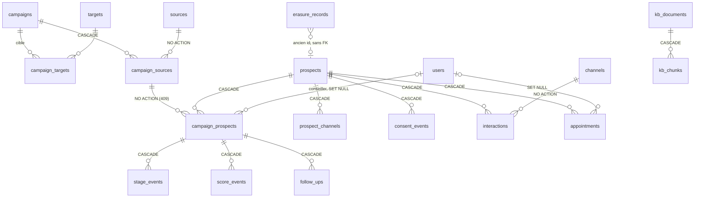

# Rapport d'audit — Données (PostgreSQL, MongoDB, Redis, pgvector)

- Date : 2026-11-11
- Branche : dev
- SHA audité : `0ee684e`
- Auditeur : agent IA (mission `docs/audit/04_DATABASE_AUDIT.md`)
- Périmètre : modèles SQLAlchemy, migrations Alembic 0001–0011, collections MongoDB et leurs index, usage de Redis,
  recherche vectorielle, séparation des données fictives, effacement et rétention, sauvegarde et restauration,
  documentation `docs/database/`.
- Exclusions : aucune base réelle ni serveur de développement consultés ; aucune migration, aucun seed, aucune purge,
  aucune restauration exécutés ; volumes réels inconnus.

## 1. Résumé exécutif

Le modèle de données est sain et cohérent avec le code : `alembic check` en CI garantit que les modèles et les
migrations ne divergent pas, les tests tournent sur un PostgreSQL et un MongoDB réels, les contraintes d'unicité
portent la déduplication (F-05) et l'effacement RGPD couvre les deux bases de façon rejouable. Aucun P0 ni P1.

Les risques sont surtout **opérationnels** :
1. sauvegardes conservées sur la même machine, non chiffrées, sans copie externe ni test de restauration
   (AUDIT-DATA-002) ;
2. traces de l'agent (`agent_runs`) et file `agent_events` sans durée de conservation (AUDIT-DATA-003) ;
3. déduplication et liste d'opposition par téléphone sans format international unique (AUDIT-DATA-001).

## 2. Périmètre et méthode

Lecture du code et des migrations ; introspection des métadonnées SQLAlchemy en local (clés étrangères, `ondelete`,
contraintes d'unicité, index), sans connexion à une base. Commandes exécutées : `git`, `grep`, `sed`, `awk` et un
script Python d'introspection de `Base.metadata`. Aucune donnée personnelle affichée.

Limites : volumes, plans d'exécution (`EXPLAIN`) et durée réelle des sauvegardes non mesurés (pas d'accès aux bases).

## 3. Cartographie

**PostgreSQL 16 + pgvector — 19 tables.** Le référentiel (`channels`, `sources`, `targets`, `users`) est protégé
par des clés étrangères sans suppression en cascade ; tout ce qui dépend d'un prospect est supprimé en cascade avec
lui.

**Matrice des contraintes clés**

| Table | Unicité | Index utiles | Suppression |
|---|---|---|---|
| `prospects` | `lower(email)`, `phone`, `linkedin_id`, `facebook_id`, `instagram_id` | — | `target`, canaux : SET NULL |
| `campaign_prospects` | (`campaign_source_id`, `prospect_id`) | étape, conseiller, prospect | prospect : CASCADE ; source : refus 409 |
| `interactions` | (`channel_id`, `external_id`) → idempotence | `conversation_ref`, (`prospect_id`, `created_at`) | prospect : CASCADE |
| `follow_ups` | — | (`status`, `scheduled_at`), `prospect_id` | CASCADE |
| `appointments` | `zoom_meeting_id`, `calendar_event_id` | — | prospect : CASCADE ; conseiller : SET NULL |
| `erasure_records` | — | `email_hash`, `phone_hash` | conservé (liste d'opposition) |
| `kb_chunks` | — | `document_id` (pas d'index vectoriel) | document : CASCADE |
| `users`, `channels`, `targets`, `sources`, `kb_documents` | nom / code / (`platform`, `external_id`) / `slug` | — | référentiel |

**MongoDB** (index créés au démarrage, `app/main.py:26-27`) :

| Collection | Contenu | Index | Conservation |
|---|---|---|---|
| `conversations` | messages embarqués, brouillons, état d'envoi | (`prospect_id`, `last_message_at`), (`status`, `last_message_at`), brouillons, livraison | effacée avec le prospect |
| `agent_runs` | traces de l'agent | (`prospect_id`, `started_at`), (`conversation_id`, `started_at`), `event_id` | effacée avec le prospect, sinon illimitée |
| `agent_events` | file de travail | (`completed`, `next_attempt_at`) | idem |
| `meta_lead_events` | marqueur d'idempotence (`_id` = leadgen_id), sans champ du lead | `_id` | lien au prospect coupé à l'effacement |
| `settings`, `leases`, `service_tokens` | réglages, verrous, jetons (empreinte) | `_id` | — |

**Redis** : seulement pingé par le contrôle de santé quand `REDIS_URL` est défini
(`backend/app/services/health.py:21-31`) ; absent de `deploy/compose.prod.yml`. Aucune donnée n'y est stockée.

**Flux entre bases** : pas de transaction commune. La cohérence repose sur l'idempotence (clé unique des
interactions, `_id` des leads Meta, `event_id` des traces), la réservation atomique d'un envoi
(`not_sent` → `sending`) et des opérations rejouables (effacement : MongoDB, puis SQL, puis MongoDB à nouveau).

## 4. Points positifs à préserver

- **Modèles = migrations, vérifié en CI** : `alembic upgrade head && alembic check` (`.github/workflows/ci.yml:46-47`).
- **Tests sur moteurs réels** : PostgreSQL dédiée et MongoDB réel en CI (`ci.yml:48-55`) ; SQLite et mongomock
  seulement en local.
- **Déduplication par la base** : unicité fonctionnelle `lower(email)` (`backend/app/models/prospect.py:30`) et
  identifiants de plateformes ; les conflits de concurrence sont rattrapés (`IntegrityError`,
  `backend/app/services/prospects.py:195,307,478`).
- **Verrous de ligne** (`with_for_update`) dans les services qui modifient un parcours : prospects, pipeline,
  scoring, relances, attribution des campagnes.
- **Effacement complet et rejouable** (`backend/app/services/erasure.py:87-155`) : PostgreSQL en cascade, trois
  collections MongoDB, liens Meta coupés, rendez-vous externes listés pour suppression manuelle, empreinte salée
  conservée seulement en cas d'opposition ou de demande.
- **Envoi sans doublon** : réservation atomique dans MongoDB et remise à `not_sent` seulement si l'échange SMTP n'a
  pas commencé (`backend/app/services/email_sync.py:250-335`).
- **Référentiel protégé** : retirer une source dont proviennent des prospects est refusé (409).
- **Chaque migration a un `downgrade`** non vide (0001 à 0011).
- **Sauvegarde PostgreSQL et MongoDB** avec contrôle de fichier vide, `umask 077` et rotation de 14 jours ;
  la restauration demande une confirmation explicite et arrête l'API (`deploy/backup.sh`, `deploy/restore.sh`).

## 5. Registre des constats

### AUDIT-DATA-001 — Téléphone sans format international unique : doublons et opposition contournable
- Catégorie : intégrité / RGPD
- Criticité : P2
- Confiance : Probable
- Preuve : `backend/app/schemas/prospect.py:13-20` (retire les séparateurs, `00` → `+`) ;
  `backend/app/models/prospect.py:36` (unicité sur la valeur brute) ; `backend/app/services/erasure.py:47-54`.
- Observation : `06 12 34 56 78` et `+33 6 12 34 56 78` donnent deux valeurs différentes. L'unicité et
  l'empreinte de la liste d'opposition portent sur ces valeurs.
- Scénario : un prospect arrive par un formulaire (`06…`) puis par WhatsApp ou Meta (`+336…`) → deux fiches. Un
  prospect effacé à sa demande revient sous l'autre format → il n'est pas reconnu comme opposé.
- Impact : doublons (F-05), relance d'une personne opposée (S-03).
- Recommandation : normaliser en E.164 avec un pays par défaut configurable (ex. bibliothèque `phonenumbers`),
  puis une migration de données qui recalcule les numéros et signale les collisions plutôt que de fusionner
  automatiquement. Les empreintes existantes ne peuvent pas être recalculées : garder l'ancien calcul en
  vérification secondaire.
- Dépendances : décision sur le pays par défaut.
- Complexité : M

### AUDIT-DATA-002 — Sauvegardes sur la même machine, non chiffrées, jamais testées
- Catégorie : continuité / sécurité
- Criticité : P2
- Confiance : Confirmé (script) ; À vérifier (planification réelle sur le serveur)
- Preuve : `deploy/backup.sh:17-37`, `deploy/restore.sh`.
- Observation : les fichiers sont écrits dans `/var/backups/iagora` sur le serveur lui-même, en clair, sans copie
  externe ni contrôle de restauration. `deploy/.env` (dont le secret JWT, dont dérive la clé de chiffrement des
  connecteurs, voir SEC-007) n'est pas sauvegardé : sans lui, les connexions chiffrées restaurées sont illisibles.
  Des données effacées restent jusqu'à 14 jours dans les sauvegardes.
- Scénario : perte ou compromission du VPS → base et sauvegardes perdues ou exposées ensemble.
- Impact : perte de données ; exposition de données personnelles.
- Recommandation : copie chiffrée hors serveur (ex. `age` ou `gpg` puis stockage objet), conservation séparée des
  secrets, test de restauration périodique sur une base jetable, mention des 14 jours dans le registre RGPD.
- Dépendances : choix d'un stockage externe ; décision DPO sur la durée.
- Complexité : M

### AUDIT-DATA-003 — Traces de l'agent et file de travail sans durée de conservation
- Catégorie : RGPD (minimisation) / volumétrie
- Criticité : P2
- Confiance : Confirmé
- Preuve : `backend/app/agents/runtime.py:35-42` (index sans TTL) ; seules suppressions dans `erasure.py`,
  `services/demo.py` et les outils de recette ; `backend/app/privacy_commands.py:20` (purge des inactifs
  manuelle).
- Observation : `agent_runs` (traces construites à partir des messages) et les `agent_events` terminés ne sont
  jamais purgés tant que le prospect existe. La purge des prospects inactifs est une commande, non planifiée.
- Scénario : un prospect actif pendant un an accumule toutes ses traces ; la collection grossit sans limite.
- Impact : conservation au-delà du nécessaire ; croissance des collections et des sauvegardes.
- Recommandation : index TTL sur `agent_events` terminés (ex. 30 jours) et durée de conservation des traces
  décidée avec le DPO (TTL ou purge planifiée) ; planifier la purge des inactifs ou la documenter dans
  l'exploitation.
- Dépendances : décision DPO (voir §7).
- Complexité : S

### AUDIT-DATA-004 — Message bloqué en `sending` après un arrêt pendant l'envoi
- Catégorie : cohérence inter-systèmes
- Criticité : P3
- Confiance : Probable
- Preuve : `backend/app/services/email_sync.py:320-335` ; aucune détection dans `backend/app/services/todo.py`
  (`sending` n'y est qu'un statut affiché, l. 242).
- Observation : si le processus est tué après le début de l'échange SMTP, le message reste `sending`. Ne pas le
  renvoyer est correct (risque de doublon), mais rien ne le signale.
- Scénario : redémarrage du conteneur pendant un envoi → le conseiller croit le message parti.
- Impact : réponse peut-être jamais reçue, sans alerte.
- Recommandation : horodater la réservation et remonter en incident « À faire » tout `sending` de plus de
  quelques minutes, pour vérification manuelle.
- Complexité : S

### AUDIT-DATA-005 — Liste « À faire » limitée à 500 conversations sans le signaler
- Catégorie : performance / exactitude
- Criticité : P3
- Confiance : Confirmé
- Preuve : `backend/app/services/todo.py:30,117,226`.
- Observation : au-delà de 500 conversations correspondantes, les plus anciennes sont ignorées sans indication.
- Impact : tâches invisibles à fort volume.
- Recommandation : renvoyer un indicateur « liste tronquée » ou paginer côté MongoDB.
- Complexité : S

### AUDIT-DATA-006 — Retours arrière de migration jamais exécutés
- Catégorie : migrations
- Criticité : P3
- Confiance : À vérifier
- Preuve : `.github/workflows/ci.yml:47` (montée seulement) ; `backend/alembic/versions/0004_conversations_to_mongodb.py`.
- Observation : les `downgrade` existent mais ne sont testés nulle part ; 0004 déplace des données entre bases et
  son retour arrière n'a pas été vérifié.
- Recommandation : en CI, `alembic downgrade base && alembic upgrade head` sur la base de test vide ; documenter
  que la reprise se fait par restauration plutôt que par `downgrade` après une migration de données.
- Complexité : S

### AUDIT-DATA-007 — Données fictives repérées seulement par le domaine de l'email
- Catégorie : séparation des données
- Criticité : P3
- Confiance : Probable
- Preuve : `backend/app/services/demo.py:18-28` ; filtres appliqués à la main dans `dashboard`, `analytics`,
  `campaigns`, `appointments`, `agents/auto.py:218`.
- Observation : un prospect fictif sans email n'est pas reconnu ; chaque nouvelle requête de statistiques doit
  penser à ajouter le filtre.
- Recommandation : garder la règle (simple et conforme à AGENTS.md), mais ajouter un test qui vérifie que chaque
  indicateur exclut un prospect `@demo.example.com`, ou une colonne `is_demo` calculée.
- Complexité : S

### AUDIT-DATA-008 — Documentation `docs/database/README.md` en partie périmée
- Catégorie : documentation
- Criticité : P3
- Confiance : Confirmé
- Preuve : `docs/database/README.md:50` (« activer l'authentification MongoDB avant déploiement », déjà fait en
  production) ; aucune mention de `erasure_records`, de l'attribution des campagnes (0009) ni du cycle de vie des
  mots de passe (0010).
- Recommandation : compléter le tableau des écarts ; garder `IA GORA.sql` comme schéma d'origine (c'est annoncé).
- Complexité : S

### AUDIT-DATA-009 — Dépendances et index mineurs
- Catégorie : hygiène
- Criticité : P3
- Confiance : Confirmé
- Preuve : `backend/app/database/clients.py:24`, `backend/app/services/health.py:21-31` ;
  `backend/app/services/service_tokens.py:57` ; `backend/app/integrations/knowledge/pg_knowledge.py:105`.
- Observation : Redis n'est utilisé que par le contrôle de santé ; la recherche d'un jeton de service se fait sur
  `hash` sans index ; `kb_chunks.embedding` n'a pas d'index vectoriel (parcours exact, correct et suffisant tant
  que la base de connaissances reste petite).
- Recommandation : retirer Redis ou documenter son usage futur ; index unique sur `service_tokens.hash` ; index
  HNSW seulement si la base dépasse quelques dizaines de milliers d'extraits.
- Complexité : S

## 6. Éléments non vérifiés

- Volumes réels, taille des documents `conversations`, plans d'exécution : pas d'accès aux bases.
- Planification effective de `backup.sh` sur le serveur et dernier succès.
- Retour arrière de 0004 sur une base contenant des conversations.
- Requêtes N+1 : les écrans principaux chargent les fiches par lot (`inbox.prospect_cards`), mais tous les services
  n'ont pas été relus.

## 7. Questions et décisions humaines

1. **DPO** : durée de conservation des traces de l'agent et des sauvegardes ; fréquence de la purge des inactifs.
2. **Pays par défaut** pour normaliser les numéros (Madagascar, France ?).
3. **Stockage externe** des sauvegardes : lequel, et qui détient la clé de chiffrement ?

## 8. Recommandations priorisées

1. AUDIT-DATA-002 : copie chiffrée hors serveur + test de restauration (avant toute mise en production réelle).
2. AUDIT-DATA-001 : normalisation E.164 et migration de données avec rapport de collisions.
3. AUDIT-DATA-003 : TTL `agent_events`, durée des traces décidée avec le DPO.
4. AUDIT-DATA-004, 005, 006 : petits correctifs groupables en une mission.
5. AUDIT-DATA-007, 008, 009 : hygiène, à traiter avec la documentation.

## 9. Fichiers et tests examinés

- `backend/app/models/*.py` (19 tables), `backend/alembic/versions/0001`–`0011`.
- `backend/app/services/{erasure,demo,todo,email_sync,meta_leads,service_tokens,lease,prospects,campaigns,health}.py`,
  `backend/app/agents/runtime.py`, `backend/app/integrations/knowledge/pg_knowledge.py`,
  `backend/app/database/{clients,session}.py`, `backend/app/main.py`, `backend/app/privacy_commands.py`,
  `backend/tests/conftest.py`.
- `deploy/backup.sh`, `deploy/restore.sh`, `deploy/compose.prod.yml`, `.github/workflows/ci.yml`.
- `docs/database/README.md`, `docs/database/IA GORA.sql`.
- Aucun test exécuté (audit en lecture seule).
