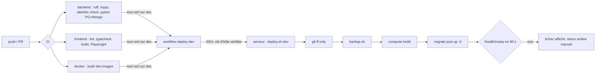

# Rapport d'audit — DevOps, infrastructure et performance

- Date : 2026-11-11
- Branche : dev
- SHA audité : `da56bae`
- Auditeur : agent IA (mission `docs/audit/10_DEVOPS_PERFORMANCE_AUDIT.md`)
- Périmètre : Dockerfiles, `deploy/compose.prod.yml`, scripts `deploy/`, workflows GitHub, configuration,
  journaux, sauvegardes, capacité.
- Exclusions : aucune commande sur le serveur, aucun déploiement, sauvegarde ou restauration ; aucun test de
  charge. **Seul l'environnement `dev` est déployé** ; la production est théorique.

## 1. Résumé exécutif

La chaîne de livraison est simple et prudente :
- la CI est verte avant tout déploiement ;
- le déploiement se fait par SSH avec une clé d'hôte vérifiée ;
- une sauvegarde est prise avant chaque migration ;
- la disponibilité de l'API est vérifiée pendant 90 s ;
- le retour arrière est documenté ;
- les images tournent sans droits root, avec des healthchecks et des limites de mémoire ;
- les journaux tournent (10 Mo × 5) ;
- les ports n'écoutent que sur `127.0.0.1`, derrière Caddy en HTTPS.

Les deux écarts majeurs pour une production :
1. les **dépendances Python ne sont pas figées** et l'image est reconstruite sur le serveur : le code déployé peut
   tourner avec d'autres versions que celles testées en CI (OPS-001) ;
2. **aucune alerte** ne prévient d'une panne, sauf si quelqu'un ouvre la console (OPS-002).

Sauvegardes : voir AUDIT-DATA-002. En-têtes de sécurité : voir SEC-003.

## 2. Cartographie du pipeline

## 3. Matrice environnement / composant / risque

| Composant | dev (déployé) | Production (théorique) | Risque |
|---|---|---|---|
| API FastAPI | 1 processus, 768 Mo, non-root, healthcheck | idem | OPS-001 (versions), ARCH-002 |
| Frontend Next.js | standalone, 256 Mo, non-root | idem | SEC-002 (Next 15.5.27) |
| PostgreSQL 16 + pgvector | réseau interne, 512 Mo, volume | idem | DATA-002 (sauvegardes) |
| MongoDB 7 | réseau interne, authentification, 512 Mo | idem | DATA-002, DATA-003 |
| Redis | absent | absent | DATA-009 |
| Caddy (hôte) | HTTPS automatique, configuration hors dépôt (`docs/deploiement.md` §4) | idem | SEC-003, API-003 |
| Migrations | service `migrate` avant l'API | idem | DATA-006 |
| `ENVIRONMENT` | `development` (instance d'essai) | `production` (modèle de `.env`) | ARCH-004, AI-002 |

## 4. Points positifs à préserver

- Déploiement gardé : `workflow_run` après la CI, `concurrency: deploy-dev` sans annulation, permissions
  `contents: read`, `StrictHostKeyChecking=yes` (`.github/workflows/deploy-dev.yml`).
- `deploy.sh` : avance rapide seulement, sauvegarde obligatoire avant migration, contrôle de disponibilité,
  commande de retour arrière affichée.
- Ports publiés sur `127.0.0.1` uniquement (`compose.prod.yml:115,132`) ; bases sur un réseau interne.
- Images : utilisateur non-root et `HEALTHCHECK` dans les deux Dockerfiles ; build du frontend en plusieurs
  étapes ; `npm ci` sur un `package-lock.json`.
- Configuration validée au démarrage (Pydantic : bornes, secret JWT d'au moins 32 caractères en production).
- Délais d'expiration sur tous les connecteurs ; opérations IMAP/SMTP dans des threads.

## 5. Registre des constats

### AUDIT-OPS-001 — Dépendances Python non figées, image reconstruite sur le serveur
- Catégorie : reproductibilité
- Criticité : P2
- Confiance : Confirmé
- Preuve : `backend/requirements.txt` (19 bornes `>=`, aucune version exacte) ;
  `backend/Dockerfile:16-18` (`pip install -r requirements.txt`) ; `deploy/deploy.sh` (`compose build` sur le serveur).
- Scénario : une bibliothèque publie une version incompatible entre la CI et le déploiement → l'API ne démarre
  pas, ou se comporte autrement que ce que les tests ont validé.
- Recommandation : un fichier de versions figées (`pip-tools` ou `uv pip compile`) utilisé par la CI et le
  Dockerfile ; mises à jour volontaires (Dependabot ou Renovate, voir OPS-004).
- Complexité : S

### AUDIT-OPS-002 — Aucune surveillance ni alerte
- Catégorie : exploitation
- Criticité : P2 (avant une production réelle)
- Confiance : Probable (rien dans le dépôt ni dans `docs/deploiement.md`)
- Preuve : `/health` et `/health/ready` existent, mais rien ne les interroge de l'extérieur ; aucune alerte sur
  l'échec d'une sauvegarde (`backup.sh` écrit dans un journal local).
- Scénario : MongoDB s'arrête un vendredi soir → les leads et les emails ne sont plus traités jusqu'à ce qu'un
  conseiller remarque l'incident.
- Recommandation : une sonde externe gratuite sur `/api/v1/health/ready` avec alerte email ; alerte en cas
  d'échec de `backup.sh` ; compteurs simples dans la console (dernier email relevé, dernier lead Meta reçu, file
  de l'agent en attente).
- Complexité : S

### AUDIT-OPS-003 — Le déploiement ne vérifie pas l'origine de la CI
- Catégorie : CI/CD
- Criticité : P3
- Confiance : Probable
- Preuve : `.github/workflows/deploy-dev.yml:5-8,20` (filtre sur la branche `dev` et la réussite seulement).
- Observation : une PR depuis un fork dont la branche s'appelle aussi `dev` déclenche un `workflow_run` pour
  `dev`. Le serveur redéploie alors la vraie branche `dev` (`deploy.sh` fait `git fetch origin dev`) : aucun code
  de la PR n'est exécuté, mais un redéploiement inutile a lieu.
- Recommandation : ajouter `github.event.workflow_run.event == 'push'` à la condition.
- Complexité : S

### AUDIT-OPS-004 — Images et dépendances suivies à la main
- Catégorie : maintenance / sécurité
- Criticité : P3
- Confiance : Confirmé
- Preuve : étiquettes flottantes `python:3.12-slim`, `node:22-alpine`, `mongo:7`, `pgvector/pgvector:pg16` ; aucun
  `dependabot.yml` ; aucune analyse des images en CI.
- Recommandation : Dependabot (pip, npm, docker, actions) en hebdomadaire, groupé ; `npm audit --omit=dev` et
  `pip-audit` en CI non bloquants dans un premier temps.
- Complexité : S

### AUDIT-OPS-005 — Contrôle après déploiement limité à l'API ; sauvegardes cumulées
- Catégorie : déploiement
- Criticité : P3
- Confiance : Confirmé
- Preuve : `deploy/deploy.sh` (seul `/health/ready` de l'API est testé) ; une sauvegarde complète par
  déploiement, gardée 14 jours.
- Observation : un frontend qui ne démarre pas passe inaperçu. Plusieurs déploiements par jour multiplient les
  sauvegardes complètes sur le même disque.
- Recommandation : tester aussi le port du frontend ; conserver au plus N sauvegardes « avant déploiement ».
- Complexité : S

## 6. Performance et capacité

Rien n'a été mesuré sur le serveur. Ce qui suit est une **estimation tirée du code**.

| Point | Constat | Effet probable |
|---|---|---|
| Boucle email | messages traités l'un après l'autre (`email_sync.py:213-231`) ; chaque passage de l'agent fait 2 à 3 appels au modèle | un afflux de 20 emails prend plusieurs minutes ; au pire, 30 s × 3 essais par appel |
| File de l'agent | 50 événements par cycle, en série (`auto.py:411-442`) ; un événement en erreur est repris toutes les 60 s sans limite | débit limité par la latence du modèle ; erreurs répétées en boucle |
| Liste « À faire » | 500 conversations examinées au plus (DATA-005) | réponse correcte mais incomplète à fort volume |
| RAG | recherche vectorielle exacte, sans index (DATA-009) | négligeable tant que la base reste petite |
| Frontend | 216 à 352 ko au premier chargement (build local) | correct pour une console interne |
| Mémoire | API 768 Mo, bases 512 Mo chacune | marge suffisante pour le volume attendu ; à surveiller (OPS-002) |

Coût : aucun suivi des jetons consommés (AI-004). Le coût Gemini ne peut pas être estimé à partir des données
actuelles.

## 7. Questions et décisions humaines

1. Hébergement de la production : même serveur que `dev`, ou serveur séparé ?
2. Quel outil d'alerte (email, téléphone) et qui reçoit les alertes ?
3. Accepter Dependabot sur le dépôt (PR automatiques hebdomadaires) ?

## 8. Recommandations priorisées

1. OPS-001 : versions figées (S).
2. OPS-002 : sonde externe et alerte d'échec de sauvegarde (S).
3. DATA-002 : copie des sauvegardes hors serveur (déjà recommandé).
4. OPS-003, 004, 005 : durcissements rapides.

## 9. Fichiers examinés

`backend/Dockerfile`, `frontend/Dockerfile`, `deploy/{compose.prod.yml,deploy.sh,backup.sh,restore.sh,env.sh,.env.production.example}`,
`.github/workflows/{ci,deploy-dev}.yml`, `backend/requirements*.txt`, `backend/pyproject.toml`, `docs/deploiement.md`,
`backend/app/agents/auto.py`, `backend/app/services/email_sync.py`. Commande exécutée : `npm run build` (local).
