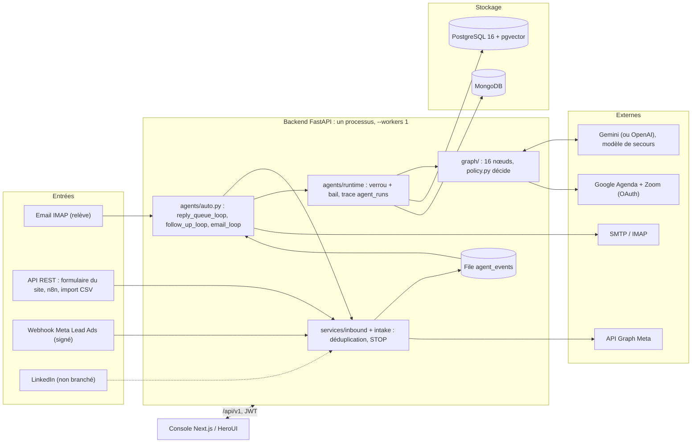
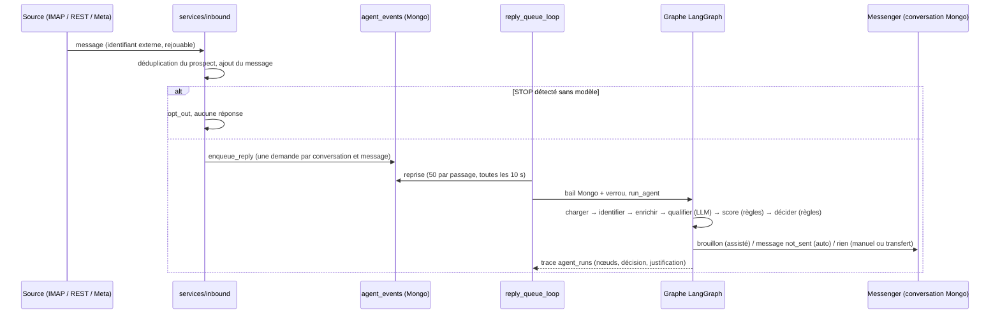
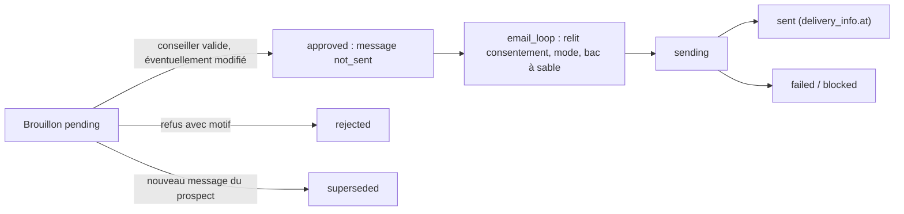

# Rapport d'audit — 01 Découverte du projet

- Date : 11/11/2026
- Branche : `dev`
- SHA audité : `080e6b69fa2c17c8a6607a54909940bade5d91c0` (merge de la PR #149, écran Agent)
- Auditeur : Claude Code, à la demande du responsable du projet
- Périmètre : cartographie factuelle du dépôt, de sa documentation et de l'espace Notion « IAGORA — Agent IA Commercial 2.0 »
- Exclusions : aucun audit spécialisé (02 à 11) ; aucune exécution contre un environnement réel ; aucun accès au serveur `dev` ni aux comptes externes

> Ce rapport ne corrige rien. Les « risques préliminaires » sont des pistes à vérifier dans les audits spécialisés : ils ne sont pas encore des constats.

## 1. Résumé exécutif

IAGORA est un monorepo **FastAPI + LangGraph** (backend) et **Next.js 15 + HeroUI v3** (console), avec **PostgreSQL 16 / pgvector** et **MongoDB**. L'architecture en ports et adaptateurs est réelle et respectée : `app/graph` n'importe aucun SDK de plateforme, et `app/agents` ne passe que par les fabriques de `app/integrations`.

Le cœur métier est implémenté et largement testé hors ligne :
- réception multicanale et déduplication ;
- STOP détecté sans modèle ;
- workflow à 16 nœuds où le LLM lit et rédige mais où des règles de code décident ;
- mode assisté par défaut ;
- relances ;
- RAG ;
- effacement RGPD ;
- console complète (les 4 écrans « À venir » sont livrés depuis le 11/11).

**Ce qui n'est pas prouvé en conditions réelles** :
- Google Agenda, Zoom et Meta Lead Ads n'ont jamais été testés avec de vrais comptes.
- La boîte email définitive de DATUM n'a pas été testée.
- Les documents officiels de la base de connaissances manquent : elle est fictive.
- La production, la restauration des sauvegardes et les quotas Gemini en usage réel sont à vérifier.

**Écarts documentaires principaux.** `architecture.md`, `passation.md` et `limites-et-dette.md` décrivent un état antérieur au 23/10 ou au 04/11. Exemples :
- Meta y est « non branché » alors qu'il l'est ;
- 9 migrations au lieu de 11 ;
- « ≈ 390 tests » au lieu de 659 ;
- Dashboard et Analytics y sont « absents ».

La page Notion de pilotage s'arrête à la PR #138, et ses liens pointent vers `main`.

**Ordre d'audit recommandé** (§11) : sécurité, puis données, puis métier et IA, avant tout pilote réel.

## 2. Périmètre et méthode

- Lecture : `AGENTS.md`, `README.md`, `docs/README.md`, `docs/architecture.md`, `docs/limites-et-dette.md`, `docs/passation.md` (début), `docs/audit/*`.
- Lecture Notion, en lecture seule : page « IAGORA — Agent IA Commercial 2.0 » (modifiée le 11/11/2026) et « Roadmap et questions ouvertes » (modifiée le 03/11/2026).
- Inventaire par commandes de lecture : `git log`, `ls`, `grep`, comparaison des champs de `app/config.py` avec `.env.example` (noms seulement, aucune valeur lue).
- Tests : aucune nouvelle exécution pour ce rapport. Les résultats cités viennent des passages du 11/11 sur les PR #145 à #149 :
  - backend : 659 réussis, 5 ignorés, couverture 90,5 % ;
  - Playwright : 189 réussis, avec l'API simulée.
- Limites :
  - aucun accès au serveur `dev`, à la base de tâches Notion détaillée, ni aux comptes Google, Zoom, Meta et IONOS ;
  - les documents métier secondaires (email, calendar, rag…) n'ont pas été relus en entier.

## 3. Stack observée et structure du dépôt

| Zone | Contenu observé |
|---|---|
| `backend/app/api/v1/` | 21 routeurs, 98 points d'entrée HTTP (`@router.*`) |
| `backend/app/services/` | 41 modules métier (prospects, conversations, brouillons, relances, email, RGPD, Meta, candidatures, analyses…) |
| `backend/app/graph/` | `builder.py`, `nodes.py`, `policy.py`, `ports.py`, `prompts.py`, `state.py` |
| `backend/app/agents/` | exécution (`runtime.py`), passerelle données (`gateway.py`), boucles de fond (`auto.py`), adaptateurs par défaut |
| `backend/app/integrations/` | `llm/` (Gemini/OpenAI via LangChain, nouveaux essais, modèle de secours), `embeddings/`, `knowledge/` (pgvector), `email/` (IMAP/SMTP), `calendar/` (Google, Zoom, OAuth, démo), `meta/` |
| `backend/app/devtools/` | jeu de démo, simulateur, scénarios, `eval-agent` (jamais en production) |
| `backend/alembic/versions/` | 11 migrations (0001 à 0011) |
| `backend/tests/` | 518 fonctions de test (659 cas avec paramétrage) |
| `frontend/src/app/` | 16 routes : `/`, `todo`, `conversations`, `appointments`, `prospects` (liste, fiche, import), `campaigns` (liste, fiche, création), `dashboard`, `analytics`, `agent`, `knowledge`, `integrations`, `team`, `settings`, `account`, `simulator`, `login` |
| `frontend/tests/` | 186 tests Playwright avec API simulée et audit axe |
| `deploy/` | `deploy.sh`, `compose.prod.yml` (postgres, mongo, migrate, api, web), `backup.sh`, `restore.sh`, `env.sh` |
| `.github/workflows/` | `ci.yml` (backend, frontend dans l'image Playwright, docker), `deploy-dev.yml` |
| `tools/n8n/` | workflow n8n et ses tests hors ligne |

**Variables d’environnement** (noms seulement), 53 dans `.env.example` : accès (JWT, CORS), bases (`POSTGRES_*`, `MONGO_*`, `REDIS_URL`), LLM (`LLM_*`, `GEMINI_API_KEY`, `OPENAI_API_KEY`), embeddings et RAG, email (`EMAIL_*`), agenda et Zoom (`CALENDAR_*`, `GOOGLE_*`, `ZOOM_*`), relances (`FOLLOW_UP_*`), `CONNECTORS_SECRET_KEY`, `AGENT_AUTO_REPLY`.

Sur ces noms, 19 champs de `app/config.py` n'apparaissent pas dans `.env.example`, par exemple `CORS_ORIGINS`, `LLM_TIMEOUT_SECONDS`, `LLM_MAX_RETRIES`, `LLM_TEMPERATURE`, `FOLLOW_UP_WINDOW_*`, `EMAIL_IMAP_FOLDER`, `CALENDAR_BUFFER_MINUTES`. Plusieurs sont réglables depuis la console (Paramètres). C'est à vérifier dans l'audit DevOps.

## 4. Diagramme des composants

## 5. Inventaire des modules et statut

| Module | Statut sur `dev` | Niveau de preuve |
|---|---|---|
| Réception REST, déduplication, file « À attribuer », import CSV | Implémenté | Tests API |
| STOP et désinscription à l'entrée (`services/inbound.py:30`) et avant envoi | Implémenté | Tests (`test_lot1_safety`, `test_review_safeguards`) |
| Workflow LangGraph : qualification, score, décision, réponse, transfert | Implémenté | Tests, scénarios hors ligne, `eval-agent` (hors ligne) |
| Modes assisté, manuel, automatique ; arrêt d'urgence | Implémenté ; le mode automatique est réservé à l'administrateur et non activable depuis la console | Tests API et navigateur |
| Brouillons : validation, modification, refus, régénération | Implémenté | Tests |
| Relances : fenêtre, plafond, annulation | Implémenté | Tests (`test_auto_agent`) |
| RAG pgvector et administration | Implémenté ; **base fictive** | Tests, `kb-eval` |
| Email IMAP/SMTP (cycle `not_sent → sending → sent/failed/blocked`) | Implémenté | Recette manuelle sur une boîte de test, déclarée par l'auteur |
| Rendez-vous Google + Zoom | Implémenté | Doublures seulement ; **jamais testé avec de vrais comptes** |
| Meta Lead Ads | Implémenté (webhook signé, mapping, simulation) | Tests et simulation ; **recette réelle en attente** |
| LinkedIn | Non branché (le mot n'apparaît que comme canal ou type de source) | — |
| Candidatures et confirmation d'inscription | Implémenté, décision humaine | Tests ; à éprouver sur de vrais emails |
| Effacement RGPD et purge par durée | Implémenté (commande manuelle) | Tests (`test_erasure`) |
| Console : 16 écrans dont Tableau de bord, Analyses, Agent (livrés le 11/11) | Implémenté | Playwright avec API simulée et axe |
| Déploiement `dev` automatique | En service selon la documentation (vérifié le 29/10) | Non vérifié dans cet audit |
| Production, sauvegardes planifiées, restauration | Non fait ou non vérifié | — |

## 6. Flux principaux

### 6.1 Message entrant → décision de l'agent

### 6.2 Brouillon → validation → envoi

Un message resté `sending` après un arrêt brutal n'est pas repris automatiquement ; c'est un choix documenté.

### 6.3 Autres flux (résumé)

- **Relance** : `follow_up_loop` → `run_due_follow_ups` (`agents/auto.py:194`). Il prend chaque relance échue dans la fenêtre d'envoi, puis la lance, l'annule ou la libère. Les relances sont annulées quand le prospect répond, se désinscrit, est transféré ou converti.
- **Rendez-vous** : décision `propose_meeting`, lecture des créneaux libres réels (port `Calendar`), choix du prospect, `book_meeting` (Google + Zoom), enregistrement dans `appointments`. Sans agenda, l'agent transfère (motifs `agenda_non_configure` / `agenda_indisponible`).
- **Effacement RGPD** : `services/erasure.py:87` `erase_prospect` (administrateur, confirmation par l'adresse). Il supprime PostgreSQL et Mongo et garde une empreinte si la personne s'est opposée. Les emails de la boîte et les événements Google/Zoom restent à supprimer à la main ; la liste est fournie.
- **Lead Meta** : webhook vérifié et signé, `meta_leads.enqueue`, `process` (API Graph), puis ingestion. Déduplication par `leadgen_id` ; le consentement reste « inconnu ».

## 7. Intégrations et niveau de validation

| Intégration | Code | Configurable | Testée en simulation | Testée en réel | Remarque |
|---|---|---|---|---|---|
| LLM Gemini (OpenAI possible) | Oui | Console et env | Oui (doublures) | Oui, recette manuelle déclarée | Quotas réels et formule payante à décider |
| Embeddings Gemini | Oui | Env | Oui (`HashEmbeddings`) | Déclaré (base de démo) | Base fictive |
| IMAP / SMTP | Oui | Console (chiffré) et env | Oui | Boîte de test seulement | Boîte DATUM à brancher |
| Google Agenda (OAuth par conseiller) | Oui | Console | Oui | **Non** | Comptes réels requis |
| Zoom (compte école ou conseillers) | Oui | Console | Oui | **Non** | Choix du mode à faire |
| Meta Lead Ads | Oui | Console (chiffré) | Oui (simulateur) | **Non** | Accès Meta et base légale |
| Formulaire du site, n8n, CSV | Oui | Jetons de service | Oui (n8n hors ligne) | n8n jamais testé sur le moteur du serveur | — |
| LinkedIn | Non | — | — | — | Bloqué : pas d'accès API |
| Redis | Déclaré | Env | Contrôle de santé seulement | — | Absent de `compose.prod.yml` |

## 8. Données et stockage

| Base | Contenu |
|---|---|
| PostgreSQL (19 tables) | `prospects`, `prospect_channels`, `consent_events`, `interactions`, `campaigns`, `campaign_targets`, `campaign_sources`, `sources`, `campaign_prospects`, `score_events`, `stage_events`, `follow_ups`, `appointments`, `channels`, `targets`, `users`, `erasure_records`, `kb_documents`, `kb_chunks` (vecteurs) |
| MongoDB | `conversations` (messages embarqués, brouillons, état de livraison), `agent_runs` (traces), `agent_events` (file), `settings` (mode de l'agent et réglages), `leases` (baux), `service_tokens`, `meta_lead_events` |

Le contenu d'un message n'existe que dans MongoDB. PostgreSQL garde le journal `interactions` avec `conversation_ref`. Il n'y a aucune transaction entre les deux bases : la cohérence repose sur l'idempotence et le rejeu, ce qui est documenté.

## 9. Couverture de tests connue

- **Backend** : 659 cas réussis et 5 ignorés, couverture de 90,5 %. Les tests tournent en local sur SQLite et mongomock, et en CI sur PostgreSQL et MongoDB réels.
- **Frontend** : 189 tests Playwright avec API simulée et audit axe. Ils ne prouvent pas l'intégration réelle avec le backend.
- **Agent** : scénarios hors ligne (CI) et `eval-agent` (46 cas). La mesure avec le vrai modèle n'a pas encore été lancée.
- **Non couvert par des tests automatiques** : les services externes réels, le moteur n8n du serveur, la restauration de sauvegarde, les montées en charge.
- **Observé le 11/11** :
  - les tests Playwright tournent contre le serveur de développement Next, qui compile les pages au premier accès, d'où deux dépassements de délai sous charge (Rendez-vous, Intégrations) ;
  - l'installation des navigateurs dépendait des dépôts Ubuntu, corrigé par l'image Playwright.

## 10. Écarts documentation / code / Notion

| Source et date | Affirmation | État sur `dev` (11/11) |
|---|---|---|
| `docs/architecture.md` (non daté) | Meta et LinkedIn « non branchés » | Meta branché (webhook, API Graph, simulation) ; LinkedIn non branché |
| `docs/architecture.md` | Migrations 0001 à 0009 | 0001 à 0011 |
| `docs/architecture.md` | Routes de la console : 9 écrans | 16 routes |
| `docs/architecture.md` | « ≈ 390 tests » backend | 659 cas |
| `docs/passation.md` | « État au 23 octobre 2026, branche `main` (PR #59) » | `dev` au-delà de la PR #149 ; tableau de bord, analyses et agent non mentionnés |
| `docs/limites-et-dette.md` | « Dashboard et Analytics absents » (P3) | Livrés (PR #145, #148) |
| `docs/limites-et-dette.md` | Ligne « durée de conservation » présente deux fois | Doublon |
| `docs/limites-et-dette.md` | « Pas de mesure suivie de la qualité des réponses » | Outil `eval-agent` livré (PR #142) ; mesure avec le vrai modèle non encore faite |
| `.env.example` | — | 19 champs de configuration absents (voir §3) |
| Notion, page principale (mise à jour du 04/11, jusqu'à la PR #138) | « Dashboard et Analytics à finaliser », « 11 écrans sur 13 » | Les écrans sont livrés ; la fiche prospect, Rendez-vous, Aujourd'hui, Tableau de bord, Analyses et Agent sont refaits (PR #143 à #149) |
| Notion, page principale | Liens vers `blob/main/docs/...` | La référence est `dev` |
| Notion, « Roadmap » (03/11) | « Dashboard et Analytics » en évolution ultérieure | Livrés |
| Notion, page principale | « Durée prévue : 90 jours ouvrables, dates à confirmer » | Dates du stage connues (14/08 au 14/12/2026) |

## 11. Zones sensibles et dépendances croisées

- **Garde-fous à ne pas modifier sans tests** : `graph/policy.py` (ordre des règles de décision, seuils), détection du STOP (`policy.is_opt_out`, `services/inbound.py`), vérification des chiffres non sourcés (`policy.ungrounded_claims`, `nodes.generate_response`), relecture du consentement et du mode avant envoi (`services/email_sync.py`), `services/drafts.py`, `services/erasure.py`.
- **Concurrence** : bail MongoDB plus verrou local par conversation (`agents/runtime.py`) ; boucles de fond dans le processus de l'API (`--workers 1` obligatoire).
- **Cohérence entre bases** : messages dans Mongo, journal et étapes dans PostgreSQL, sans transaction.
- **Secrets** : connecteurs chiffrés avec `CONNECTORS_SECRET_KEY`. La rotation n'est pas étudiée ici.
- **Front** : jeton JWT dans `localStorage` (connu, P2).

## 12. Risques préliminaires (à confirmer dans les audits spécialisés)

| Piste | Audit | Indice |
|---|---|---|
| Dépendances npm : la CI signale 8 vulnérabilités (6 modérées, 1 élevée, 1 critique) | 05 Sécurité | Journal `npm ci` du 11/11 |
| Jeton dans `localStorage`, limitation des connexions en mémoire | 05 Sécurité | `limites-et-dette.md` |
| Message `sending` non repris après un arrêt brutal ; pas de transaction entre les bases | 04 Données, 07 Métier | `limites-et-dette.md` |
| Réponses multiples à des emails rapprochés du même prospect | 07 Métier | `limites-et-dette.md` |
| Recette réelle absente pour l'agenda, Zoom et Meta ; base de connaissances fictive | 08 IA et intégrations | §7 |
| Tests e2e sur le serveur de dev (délais sous charge) ; actions GitHub en Node 20 dépréciées | 09 QA, 10 DevOps | Journaux CI du 11/11 |
| Production, sauvegardes hors serveur et restauration non vérifiées | 10 DevOps | `deploiement.md` §8 |
| `.env.example` incomplet | 10 DevOps | §3 |

## 13. Questions ouvertes pour le responsable

1. La mise à jour des documents en retard (`architecture.md`, `passation.md`, `limites-et-dette.md`, Notion) fait-elle partie de l'audit, en constat seulement, ou d'une mission séparée ?
2. Les audits spécialisés peuvent-ils lancer les tests backend et Playwright en local (sûrs, données fictives), ou doivent-ils rester en lecture statique ?
3. Faut-il inclure le serveur `dev` (en lecture seule) dans l'audit 10, ou rester sur le dépôt ?
4. Quelle échéance pour un pilote réel avec DATUM ? Elle fixe le seuil P1 / P2.

## 14. Ordre recommandé des audits

1. **05 Sécurité** : vulnérabilités npm, jeton, webhooks, chiffrement des connecteurs, garde-fous de production.
2. **04 Données** : cohérence PostgreSQL et Mongo, idempotence, effacement RGPD.
3. **07 Métier** et **08 IA et intégrations**, ensemble : STOP, consentement, modes, NF-10, transferts, connecteurs.
4. **02 Architecture** et **03 Backend/API**.
5. **06 Frontend/UX**, **09 QA**, **10 DevOps/performance**.
6. **11 Feuille de route** de modernisation, en consolidation.

C'est l'ordre du référentiel, avancé pour la sécurité et les données : ce sont les deux domaines où un défaut aurait un impact immédiat sur de vrais prospects.

## 15. Fichiers examinés

`AGENTS.md`, `README.md`, `docs/README.md`, `docs/architecture.md`, `docs/limites-et-dette.md`, `docs/passation.md`, `docs/audit/*`, `.env.example`, `docker-compose.yml`, `deploy/compose.prod.yml`, `.github/workflows/ci.yml`, `backend/app/config.py`, `backend/app/main.py`, `backend/app/agents/auto.py`, `backend/app/services/inbound.py`, `backend/app/services/agent_events.py`, `backend/app/services/erasure.py`, `backend/app/services/meta_leads.py`, imports de `backend/app/graph` et `backend/app/agents`, arborescences `backend/app`, `backend/alembic/versions`, `backend/tests`, `frontend/src/app`, `frontend/tests`, `deploy`, `tools`. Notion : page principale du projet et « Roadmap et questions ouvertes ».
