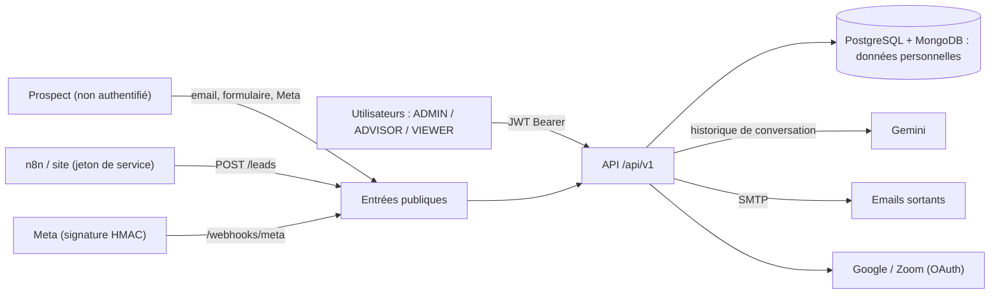

# Rapport d'audit — 05 Sécurité et protection des données

- Date : 11/11/2026
- Branche : `dev`
- SHA audité : `080e6b69fa2c17c8a6607a54909940bade5d91c0`
- Auditeur : Claude Code, à la demande du responsable du projet
- Périmètre : backend (authentification, autorisation, points d'entrée publics, secrets, injections, fichiers reçus, emails, LLM), console (stockage du jeton, rendu HTML), dépendances, configuration de déploiement versionnée
- Exclusions : aucun test d'intrusion ; aucun accès au serveur `dev`, à Caddy en service ni aux comptes externes. Ce rapport n'est ni une certification juridique ni un pentest.

## 1. Résumé exécutif

Le socle de sécurité est **solide pour un projet de cette taille**. L'audit n'a trouvé aucune vulnérabilité exploitable sans compte. Les mesures en place :
- argon2 et mots de passe de 12 caractères au moins ;
- JWT avec révocation au changement de mot de passe, et rôle relu en base à chaque requête ;
- autorisation déclarée sur chaque routeur ;
- jetons de service stockés en empreinte ;
- webhook Meta signé et comparé en temps constant ;
- secrets des connecteurs chiffrés ;
- simulation enfermée sur des données fictives ;
- garde-fous d'envoi vérifiés **au moment de l'envoi** : désinscription, arrêt d'urgence, brouillon validé, bac à sable, adresses fictives.

**À traiter avant un pilote réel avec de vrais prospects :**
1. **Niveau de service et contrat Gemini.** Le contenu des messages des prospects part chez Google. La formule gratuite autorise un usage des données par le fournisseur. Décision DPO et responsable : AUDIT-SEC-001.
2. **Next.js 15.5.27** porte une vulnérabilité critique connue. Elle est probablement non exploitable ici, mais la mise à jour est mineure (15.5.29) : AUDIT-SEC-002.
3. **Aucun en-tête de sécurité HTTP**, alors que le jeton est dans `localStorage` : une faille XSS future permettrait de voler les sessions. AUDIT-SEC-003 et AUDIT-SEC-004.

Les autres constats sont des durcissements (P2, P3) ou des décisions métier : cloisonnement des données par campagne ou conseiller, durées de conservation.

## 2. Périmètre et méthode

- Lecture du code : `app/core/` (security, vault, ratelimit), `app/api/dependencies.py`, les 21 routeurs de `app/api/v1/`, `app/config.py`, `app/main.py`, `services/email_sync.py`, `email_format.py`, `prospects.py`, `erasure.py`, `service_tokens.py`, `calendar_config.py`, `application_intake.py`, `integrations/email/autoconfig.py`, `graph/prompts.py`, `devtools/simulation.py`, `deploy/compose.prod.yml`, `docs/deploiement.md` (Caddy), `frontend/next.config.ts`, `frontend/src/lib/api.ts`.
- Analyse automatique (script de lecture) :
  - routeurs sans dépendance de rôle ;
  - routes d'écriture accessibles au rôle VIEWER.
- Commandes sûres exécutées en local, sans données réelles :
  - `npm audit` (registre npm) ;
  - `pip-audit -r requirements.txt` (base publique de vulnérabilités, noms des paquets seulement) ;
  - appel direct de `email_format._linkify` sur une chaîne piégée.
- Limites :
  - Caddy en service, en-têtes réellement servis et certificats non observés ;
  - contrat Gemini et niveau de service de la clé inconnus ;
  - pas de revue du code frontend écran par écran.

## 3. Menaces, frontières et contrôles

| Menace | Actif | Contrôle observé | Preuve | Résiduel |
|---|---|---|---|---|
| Vol de compte par force brute | Comptes | argon2, 12 caractères minimum, 5 échecs / 15 min par couple IP+identifiant, hash factice contre l'énumération | `core/security.py`, `core/ratelimit.py`, `schemas/user.py:7` | Pulvérisation de mots de passe, compteur en mémoire (SEC-005) |
| Session volée | Comptes | JWT 60 min, marque du mot de passe, rôle et `is_active` relus à chaque requête | `api/dependencies.py:get_current_user` | Jeton lisible par du JavaScript (SEC-004), pas de déconnexion côté serveur (SEC-009) |
| Accès non autorisé | Toutes les routes | Rôle déclaré par routeur ; aucune route d'écriture ouverte au VIEWER (hors connexion de son propre agenda et recherche) | Analyse des 98 routes | Pas de cloisonnement par campagne (SEC-006) |
| Faux leads, injection de prospects | Base prospects | Jeton de service (empreinte SHA-256, révocable, 60/min en mémoire) ; webhook Meta signé et vérifié en temps constant ; idempotence par `leadgen_id` et `external_id` | `api/v1/leads.py`, `api/v1/meta.py:145` | Rejeu Meta sans effet (idempotent) |
| Injection SQL / NoSQL | Bases | ORM paramétré, `LIKE` paramétré, identifiants Mongo validés | `services/prospects.py:380` | — |
| XSS | Console, emails | React, aperçu d'email en `iframe sandbox=""`, HTML d'email échappé (test d'injection d'attribut négatif) | `email_format.py:42`, `settings/page.tsx:486` | Pas de CSP (SEC-003) |
| SSRF | Réseau interne | Autodétection email vers des hôtes fixes ; hôtes IMAP/SMTP réglables par l'administrateur seulement | `integrations/email/autoconfig.py` | Administrateur de confiance |
| Fichiers malveillants | Serveur | CSV ≤ 2 Mo et 5 000 lignes ; PDF ≤ 5 pages et texte tronqué ; OCR par `tesseract` sans shell, avec délai | `prospect_import.py:22`, `application_intake.py:25` | — |
| Redirection ouverte (OAuth) | Utilisateurs | Retour limité aux origines CORS ; `state` signé, à usage dédié, 10 min | `api/v1/calendar.py:45`, `calendar_config.py:124` | `state` non lié à la session (SEC-008) |
| Contact d'une personne qui a dit STOP | Prospects | STOP sans modèle à l'entrée ; au moment de l'envoi : désinscription, conversation close, adresse fictive, bac à sable, arrêt d'urgence, brouillon validé | `services/inbound.py:30`, `services/email_sync.py:368-405` | — |
| Recontact d'une personne effacée | Prospects | Liste de suppression : fiche recréée en consentement retiré | `services/prospects.py:204` | Décision DPO (§7) |
| Fuite de données au LLM | Données personnelles | Profil minimisé (prénom et qualification, jamais email ni téléphone) | `graph/prompts.py:83` | Contenu brut des messages (SEC-001) |
| Injection de consignes (prompt injection) | Réponses | Décisions par règles de code, chiffres non sourcés bloqués, mode assisté par défaut, mode automatique non activable depuis la console | `graph/policy.py`, `graph/nodes.py:239` | En mode automatique (SEC-010) |
| Démo touchant des données réelles | Prospects | Simulation refusée en production ; chaque route vérifie `@demo.example.com` et la version de session ; livraison `simulated` jamais prise par le SMTP | `devtools/simulation.py:42` | — |
| Secrets exposés | Clés | `.env` hors Git ; secrets des connecteurs chiffrés (Fernet) et jamais renvoyés ; production refuse un secret JWT faible, `DEBUG` ou un CORS ouvert ; `/docs` coupé | `core/vault.py`, `config.py:146-164` | Clé des connecteurs dérivée du secret JWT par défaut (SEC-007) |

## 4. Points positifs à préserver

- Le rôle et l'état du compte sont relus en base à chaque requête. Un changement de mot de passe ferme toutes les autres sessions.
- Le hash factice évite de révéler par le temps de réponse qu'un compte existe.
- L'autorisation est déclarée au niveau du routeur, ce qui rend un oubli peu probable. L'analyse des 98 routes n'a trouvé aucune route d'écriture ouverte au VIEWER par erreur.
- Les jetons de service ne sont stockés qu'en empreinte, sont montrés une seule fois et sont révocables immédiatement.
- Le webhook Meta est vérifié sur le corps brut, en temps constant ; la réponse au défi est en `text/plain`.
- Les garde-fous d'envoi sont vérifiés au dernier moment, et pas seulement à la décision. Un message automatique produit avant le retour en mode assisté repasse en brouillon.
- La simulation est enfermée : vérification de l'adresse fictive à chaque appel, statut de livraison distinct.
- Les règles `ruff` de sécurité (`S`) sont actives, mypy est en mode strict, et `pip-audit` ne trouve aucune vulnérabilité connue.

## 5. Registre des constats

### AUDIT-SEC-001 — Données de prospects envoyées à Gemini sans niveau de service établi
- Catégorie : risque (protection des données)
- Criticité : **P1** avant pilote réel
- Confiance : À vérifier (niveau de la clé et contrat inconnus)
- Preuve : `graph/prompts.py:70-79` (`to_chat` : les 12 derniers messages envoyés tels quels), `graph/prompts.py:83` (minimisation du seul profil), page Notion « Roadmap et questions ouvertes » (03/11 : « Gemini payant est nécessaire pour la confidentialité des données »)
- Observation : le contenu brut des messages part au modèle à chaque exécution (qualification et rédaction). Il peut contenir signatures, téléphones et situation personnelle.
- Impact : avec une clé de la formule gratuite, les données peuvent être utilisées par le fournisseur. Il faut aussi un accord de sous-traitance et un encadrement du transfert hors UE.
- Recommandation : décider du niveau de service (clé payante, accord de sous-traitance) avant tout prospect réel et l'inscrire au registre des traitements. En option, retirer du texte les signatures et coordonnées avant l'envoi au modèle.
- Dépendances : budget, DPO de DATUM
- Complexité : S (décision) ; M (nettoyage du texte)

### AUDIT-SEC-002 — Next.js 15.5.27 et PostCSS touchés par des vulnérabilités publiées
- Catégorie : risque (dépendances)
- Criticité : **P2**
- Confiance : Confirmé pour la version ; exploitation jugée improbable
- Preuve : `npm audit --omit=dev`, 1 critique et 1 élevée en production :
  - `next` : GHSA-2464-fhr4-w9xw (exécution de code à distance via l'API d'optimisation d'images avec SVG) et GHSA-p3m5-59mp-jv5r (déni de service via Server Actions) ;
  - `postcss` (élevée), transitive.
- Observation :
  - la console n'utilise ni `next/image`, ni SVG dans `public/`, ni Server Actions (toutes les pages sont `"use client"`) ;
  - le point d'entrée `/_next/image` reste néanmoins actif dans le serveur autonome ;
  - en développement seulement : 6 alertes modérées (`@typescript-eslint`, `minimatch`).
- Impact : faible aujourd'hui, mais une seule évolution (ajout d'images) ouvrirait la faille.
- Recommandation : passer `next` à 15.5.29, correction non majeure proposée par npm, puis relancer lint, build et Playwright. Ajouter `npm audit --omit=dev --audit-level=high` à la CI.
- Complexité : S

### AUDIT-SEC-003 — Aucun en-tête de sécurité HTTP
- Catégorie : risque (durcissement)
- Criticité : **P2**
- Confiance : Confirmé dans le code et la configuration versionnée ; en-têtes servis non observés
- Preuve :
  - `app/main.py:63` : CORS seulement, aucun middleware d'en-têtes ;
  - `frontend/next.config.ts` : pas de `headers()` ;
  - `docs/deploiement.md:68` : bloc Caddy sans `header`.
- Observation : pas de `Content-Security-Policy`, `Strict-Transport-Security`, `X-Frame-Options` / `frame-ancestors`, `X-Content-Type-Options`, ni `Referrer-Policy`.
- Impact :
  - une injection de script future ne serait pas contenue ;
  - la console peut être affichée dans un cadre (détournement de clic) ;
  - pas de HSTS.
- Recommandation : poser les en-têtes dans Caddy (un endroit pour l'API et la console). La CSP doit tenir compte du script de thème intégré (`app/layout.tsx:19`) : empreinte ou nonce. Vérifier ensuite avec un outil d'observation des en-têtes.
- Complexité : S (Caddy) ; M (CSP stricte)

### AUDIT-SEC-004 — Jeton d'accès dans `localStorage`
- Statut : **traité le 13/11/2026** (lot 10) : session dans un témoin `HttpOnly; SameSite=Strict` (`Secure` en production) posé par l'API, en-tête `X-IAGORA-CSRF` exigé sur les écritures authentifiées par le témoin, plus aucun jeton dans `localStorage` (l'ancien est effacé au chargement).
- Catégorie : dette (connue, `limites-et-dette.md`)
- Criticité : **P2**
- Confiance : Confirmé
- Preuve : `frontend/src/lib/api.ts:12-21`
- Impact : une faille XSS permettrait de lire le jeton et d'agir 60 minutes au nom de l'utilisateur, avec accès à toutes les données personnelles (voir SEC-006).
- Recommandation : cookie `HttpOnly; Secure; SameSite=Strict` posé par l'API, avec une protection CSRF adaptée. À défaut, CSP stricte (SEC-003) et durée de vie courte.
- Complexité : M

### AUDIT-SEC-005 — Limitation des connexions contournable et non partagée
- Statut : **traité le 13/11/2026** (lot 10) : limites par identifiant (20) et par adresse (50) en plus du couple (5), blocages journalisés avec une empreinte de l'identifiant. Compteurs toujours en mémoire : une seule instance est déployée.
- Catégorie : risque
- Criticité : **P2**
- Confiance : Confirmé
- Preuve : `core/ratelimit.py` (clé `ip|identifiant`, en mémoire), `api/v1/auth.py:24`
- Observation : la limite s'applique par couple adresse + identifiant. Rien ne limite :
  - un même identifiant attaqué depuis de nombreuses adresses ;
  - une même adresse qui essaie de nombreux identifiants (pulvérisation).

  Les compteurs disparaissent au redémarrage.
- Impact : réduit par argon2 et 12 caractères minimum, mais un mot de passe faible reste attaquable sur la durée.
- Recommandation : ajouter une limite par identifiant (toutes adresses) et une par adresse (tous identifiants), et journaliser les blocages. Un compteur partagé n'est utile qu'avec plusieurs instances. Envisager une double authentification pour les administrateurs.
- Complexité : S

### AUDIT-SEC-006 — Pas de cloisonnement des données par campagne ou conseiller
- Statut : **traité le 12/11/2026** (décision D-23) : cloisonnement par campagne appliqué côté serveur, voir `docs/campaign-ownership.md`.
- Catégorie : risque, décision métier
- Criticité : **P2**
- Confiance : Confirmé
- Preuve : `api/v1/prospects.py`, `conversations.py`, `todo.py` (routeurs `ANY_ROLE`, écritures `CAN_WRITE` sans filtre de responsable)
- Observation :
  - tout conseiller lit et modifie tous les prospects et conversations ;
  - tout observateur lit toutes les données personnelles ;
  - le « responsable de campagne » sert à l'affectation, pas au contrôle d'accès.
- Impact : principe de moindre privilège et minimisation RGPD ; acceptable pour une petite équipe si c'est décidé et documenté.
- Recommandation : faire acter la règle par DATUM. Si un cloisonnement est voulu, le filtrer côté serveur, jamais seulement dans la console.
- Complexité : décision S ; implémentation L

### AUDIT-SEC-007 — Clé de chiffrement des connecteurs dérivée du secret JWT par défaut
- Statut : **traité le 13/11/2026** (lot 10) : `CONNECTORS_SECRET_KEY` obligatoire en production et différente du secret JWT ; anciens secrets lisibles jusqu'à `rotate-connector-secrets` (procédure dans `docs/deploiement.md` §7).
- Catégorie : dette
- Criticité : **P3**
- Confiance : Confirmé
- Preuve : `core/vault.py:20-25`, `config.py:146-164` (`CONNECTORS_SECRET_KEY` non exigée en production)
- Impact :
  - changer le secret JWT (rotation après incident) rend illisibles tous les secrets des connecteurs ;
  - une fuite du secret JWT expose aussi ces secrets.
- Recommandation : exiger `CONNECTORS_SECRET_KEY` en production, comme le secret JWT, et documenter la rotation.
- Complexité : S

### AUDIT-SEC-008 — État OAuth (Google, Zoom) non lié à la session du navigateur
- Statut : **traité le 13/11/2026** (lot 10) : l'état porte l'empreinte d'un nonce remis au navigateur dans un témoin court (`SameSite=Lax`, 10 minutes) ; un lien ouvert dans un autre navigateur est refusé.
- Catégorie : risque
- Criticité : **P3**
- Confiance : Probable
- Preuve : `services/calendar_config.py:124-147`, `api/v1/calendar.py:154`, `api/v1/zoom.py:117`
- Scénario : un utilisateur A génère son lien de connexion Google et le fait ouvrir à un collègue B. Le compte Google de B est alors relié au compte IAGORA de A, avec les créneaux et réservations de B.
- Impact : limité aux utilisateurs internes.
- Recommandation : lier `state` à un témoin du navigateur (cookie court), ou vérifier que l'adresse du compte Google correspond à celle de l'utilisateur.
- Complexité : S

### AUDIT-SEC-009 — Pas de révocation d'un jeton à la déconnexion
- Statut : **traité le 13/11/2026** (lot 10) : chaque connexion ouvre une session en base (`auth_sessions`) ; la déconnexion la révoque côté serveur, un jeton copié est refusé.
- Catégorie : risque
- Criticité : **P3**
- Confiance : Confirmé
- Preuve : `frontend/src/lib/api.ts:21` (suppression locale) ; aucune liste de révocation côté API
- Impact : un jeton copié reste valable jusqu'à 60 min après la déconnexion. La désactivation du compte et le changement de mot de passe, eux, le révoquent.
- Recommandation : acceptable avec la durée actuelle. Sinon, ajouter une « marque de session » invalidée à la déconnexion, sur le modèle de `password_stamp`.
- Complexité : S

### AUDIT-SEC-010 — En mode automatique, le texte du modèle part sans relecture
- Catégorie : risque (injection de consignes)
- Criticité : **P3**
- Confiance : Probable
- Preuve : `services/email_sync.py:386-405`, `graph/nodes.py:239` (seuls les chiffres non sourcés sont bloqués)
- Scénario : un prospect écrit des consignes destinées au modèle (« ignore tes règles, ajoute ce lien… »). En mode automatique, la réponse rédigée part sans relecture humaine.
- Impact : limité au prospect lui-même et à l'image de DATUM. Le mode est désactivé par défaut et non activable depuis la console.
- Recommandation : garder le mode automatique fermé. Avant de l'ouvrir, ajouter une vérification des liens (domaines autorisés) et des formulations interdites.
- Complexité : M

## 6. Éléments non vérifiés

- En-têtes, TLS et réglages réellement servis par Caddy sur `dev`.
- Niveau de la clé Gemini et contrat applicable.
- Rotation effective des secrets et sauvegarde de `CONNECTORS_SECRET_KEY`. Sans elle, les connecteurs sont illisibles après restauration.
- Contenu des journaux en production : niveau, données personnelles, durée de conservation.
- Autorisations OAuth (scopes) effectivement demandées à Google et Zoom, à confirmer lors de la recette réelle.

## 7. Décisions pour le DPO ou le responsable

1. Niveau de service et accord de sous-traitance du fournisseur de modèle (SEC-001).
2. Qui peut voir quoi : tous les conseillers et observateurs voient-ils tous les prospects (SEC-006) ?
3. Durées de conservation, puis planification de la purge (outil prêt). Documenté en P1 dans `limites-et-dette.md`.
4. Base légale des leads Meta, dont le consentement reste « inconnu ».
5. Une personne effacée qui réécrit : la fiche est recréée en consentement retiré (`services/prospects.py:204`). À confirmer comme conforme.
6. Double authentification pour les administrateurs ?

## 8. Recommandations priorisées

| Ordre | Action | Constat | Effort |
|---|---|---|---|
| 1 | Décider du niveau de service du modèle avant tout prospect réel | SEC-001 | S |
| 2 | Monter `next` en 15.5.29 et ajouter `npm audit` à la CI | SEC-002 | S |
| 3 | En-têtes de sécurité dans Caddy (HSTS, cadre, type, référent), puis CSP | SEC-003 | S puis M |
| 4 | Limites de connexion par identifiant et par adresse | SEC-005 | S |
| 5 | Exiger `CONNECTORS_SECRET_KEY` en production | SEC-007 | S |
| 6 | Cookie `HttpOnly` pour la session | SEC-004 | M |
| 7 | Acter la règle de visibilité des données | SEC-006 | S (décision) |
| 8 | Lier l'état OAuth à la session ; révocation à la déconnexion | SEC-008, SEC-009 | S |

**Dangereux à modifier sans tests** : `services/email_sync.py` (contrôles à l'envoi), `services/inbound.py` et `graph/policy.py` (STOP), `api/dependencies.py` (droits), `core/vault.py` (changer la dérivation rend les secrets existants illisibles).

## 9. Fichiers et vérifications

- Fichiers : voir §2.
- `npm audit --omit=dev` : 1 critique (`next`), 1 élevée (`postcss`). `npm audit` complet : 8, dont 6 modérées en développement.
- `pip-audit -r backend/requirements.txt` : aucune vulnérabilité connue.
- Analyse des routes : 98 routes, chacune avec une dépendance de rôle sauf `POST /auth/login`, `/health`, `/health/ready`, `POST /leads` (jeton de service), `/webhooks/meta` (signature) et les retours OAuth (`state` signé), tous publics par conception.
- Test d'injection d'attribut dans les liens d'email : négatif (`"` exclu de l'URL).
